> For the short beginner guide, start with [README](../README.md).

# Detailed usage and technical reference

Forza Mod Tool supports GameDB editing and merging for FH2, FH5, FH6 and Forza Motorsport (FM8). Profile Editor and Garage Viewer support FH6 and FH2/Azimuth saves. Save Swap is FH6-only, and FH5 profile saves are decrypt-only in Crypto.

Download and extract `FH6LocalModTool_v1.3.0.zip` from the release assets. See [what changed since 1.2.6.3](../CHANGELOG.md).

## Table of contents

- [Features](#features)
- [Requirements](#requirements)
- [Game support](#game-support)
- [FH2 / Azimuth](#fh2--azimuth)
- [FH5](#fh5)
- [Before you begin](#before-you-begin)
- [Beginner overview](#start-here-a-beginners-guide)
- [Required GameDB folder setup](#required-gamedb-folder-setup)
- [Your first complete car edit](#your-first-complete-car-edit)
- [Which buttons require Apply?](#which-buttons-require-apply)
- [Output-name cheat sheet](#output-name-cheat-sheet)
- [Section 1: Crypto](#section-1-crypto)
- [Share or import a car DB](#share-or-import-a-car-db)
- [Merge after a game update](#merge-after-a-game-update)
- [Section 2: Car Editor](#section-2-car-editor)
- [Section 3: Animation Swap](#section-3-animation-swap)
- [Section 4: Save Swap](#section-4-save-swap)
- [Section 5: Profile Editor](#section-5-profile-editor)
- [Garage Viewer / Garage Editor (FH6)](#garage-viewer--garage-editor-fh6)
- [Section 6: DB Browser](#section-6-db-browser)
- [Section 7: Forza Motorsport (FM8)](#section-7-forza-motorsport-fm8)
- [Temporary workspace](#temporary-workspace)
- [Troubleshooting](#troubleshooting)
- [Advanced technical reference](#advanced-technical-reference)
- [Video guide](#video-guide)
- [Disclaimer](#disclaimer)
- [Credits](#credits)

## Features

Version **1.3.0** adds FH2/FH5 support, FH2 save editing, mm-per-side track widths and size labels, engine naming, car buckets, expanded stock restore, native thumbnails and a DB Browser scratch pad. Each tab has editable **?** help that can stay open while you use the tool.

- Decrypt and re-encrypt GameDB `.slt` containers.
- Decrypt, edit, and re-encrypt supported text assets such as INI, XML, JSON, TXT, and extensionless configuration files.
- Decode unencrypted `.skeld` skeletons to editable JSON and rebuild validated binary copies.
- Authenticate and extract encrypted ZIP entries.
- Open and export an encrypted `.slt` directly in Car Editor; SQLite remains supported.
- Selectively merge `.slt` or SQLite databases, including mixed-format inputs.
- Select exactly which donor database tables and rows are merged into the staged database.
- Export one car or a Ctrl/Shift-selected car pack into one related-row donor DB. Import normally or use **Drop & rebuild** to replace the donor cars' existing mods.
- Keep the receiving GameDB's version metadata unchanged during normal merges/imports; only **Merge updated DB** advances it.
- Carry additions, edits and deliberate deletions onto a clean updated database through **Merge updated DB**, using a version-matched clean baseline.
- Edit car availability, prices, engines, motors, fitment, wheelbase, drivetrains, tires, suspension, handling, and per-engine power settings.
- Batch-edit multiple cars with append-only, duplicate-safe upgrade creation.
- Compare a loaded database against an embedded stock reference, filter modified cars, and restore individual cars.
- Swap complete front- or rear-door animations from a built-in donor library, manage CLIPD channels, and adjust supported animation endpoints.
- Edit either a complete car ZIP or a raw `carclips_<ID>.clipd` file and save a verified copy.
- Apply the animation-side database stance compatibility fix and access experimental non-door channels.
- Build ProfileData save swaps while retaining the target save's container framing and canonical account XUID.
- Edit supported ProfileData values through a friendly Overview while retaining advanced SQLite, property-tree, Save State, Career, and XML views.
- Discover all roads, unlock clothes, horns, emotes and Forza Link reward phrases, and complete Collection Journal challenges with automatic points, bonuses and Festival wristband progression.
- Browse your FH6 garage by manufacturer with friendly car names and actual per-instance cached thumbnails.
- Add stock cars, duplicate an instance, remove selected cars, and set the current car in a private save working copy.
- Edit Original Owner, Distance Driven, and Top Speed individually or in batches, changing only the fields you select.
- Decrypt complete FH5/FH6 profile streams in Crypto; re-encrypt FH6 using the original profile template. FH5 saves support decryption only.
- Resize garage lists and Car Editor panels, including the engine/motor list.
- Edit FH2/Azimuth balances, XP, boards, roads, perks, photography and supported championships; manage its garage in the dedicated FH2 view.
- Use stock thumbnails directly from FH2/FH5/FH6 resource ZIPs, with remembered sources for each game.
- Edit car buckets and stock engine labels, and restore a selected car's own records while preserving shared parts and engine names.
- Keep session notes in DB Browser's scratch pad, with TXT import/export.
- Create renamed output files without overwriting the input files.

## Requirements

The release executable supports Windows 10/11 x64 and does not require a separate .NET installation. Building from source requires the .NET 8 SDK.

## Game support

| Game | GameDB / Car Editor | Save support |
|---|---|---|
| FH2 | Open plain SLT or SQLite; native supported options | Profile Editor and Garage Viewer for Azimuth revision saves |
| FH5 | SLT decrypt/re-encrypt and direct Car Editor loading | Crypto decryption only |
| FH6 | SLT decrypt/re-encrypt and direct Car Editor loading | Profile Editor, Garage Viewer and Save Swap |
| FM8 | Decrypt to SQLite before Car Editor/DB Browser; re-encrypt afterward | No save editing |

The game is detected from the file. Normal merge, Merge updated DB, car export/import and body-kit import support all four games, using same-game inputs. FH2 SLTs stay plain. FH5/FH6/FM8 encrypted exports need the matching original template. Stock comparison, names and restore use a same-game, same-build embedded reference; FM8 has no embedded stock reference.

The **?** button opens a short, non-blocking guide. Edit its `Help/*.txt` file beside the EXE and reopen the guide to reload the text. The app's support and Discord links are beside the version number.

## FH2 / Azimuth

### GameDB editing

Open `Mount\media\stripped\gamedbRC.slt` directly. It is already SQLite. Apply your changes and **Export SLT**; do not encrypt the FH2 output with an FH5/FH6 template. Use your existing Azimuth mod setup to install the plain SLT. With Extra Options, a higher-priority `mediaoverride` or `mediapc` copy can hide changes in the original `media` folder.

Supported options include engines/motors, power, rims, tire widths, wheelbase, buckets, vintage tires and Race/Rally suspension. Custom drift adds an extra Race-tier part. Its optional steering-angle override affects the whole car: uncheck the override and Apply to restore stock steering after reopening. Tire-profile and track-width controls are disabled for FH2; use the separate FH2 wheel mod. See [FH2 Car Editor notes](FH2-CAR-EDITOR.md).

### Profile and garage

1. Back up the whole Azimuth `User_<account>` save folder.
2. Click **FH2 save…** in Profile Editor or Garage Viewer. Choose a revision, its `data` folder or `revisions` to load the latest revision.
3. Edit credits, available skill points, wheelspins or Driver XP, then Apply. The level/wristband is a read-only preview; there is no separate level Apply.
4. Progress buttons cover mainland/Storm Island boards and roads, all perks, owned-car photography, camera discovery and supported championships.
5. In Garage Viewer, add/duplicate/remove supported cars or edit owner/distance/top speed. Batch Original Owner changes labels only; distance and top speed remain single-car fields.
6. **Export save** writes a complete revision. Close FH2 and Azimuth and back up the whole `User_<account>` save folder. Copy the same exported `commit` and entire `data` folder into **both folders inside `revisions`**, replacing their contents. Replacing only one can stop the edited save loading. Keep both existing folder names; the revision numbers change as the game saves. Never mix a commit with different blobs.

Typical path:

```text
<Azimuth>\data\titles\1A96545B\saves\player-1\User_<account>\revisions\<revision>\
```

Mainland completion covers 168 championships / 672 races. **All mainland + finales** also completes both finales and repairs post-story progression. One-destination completion covers 28 championships without changing the story. Storm Island covers 29 pre-finale championships / 88 races after its introduction; the final gauntlet and island story are excluded. Camera discovery reveals locations without creating scores or completing the cameras. Completion buttons do not grant XP, credits, spins or reward cars.

FH2 saves, roads on both maps, remaining mapped fields and Extra Options compatibility were confirmed in-game. Current/pending and barn-find car protections still apply. This supports Azimuth revision saves, not Xbox 360/STFS containers. See [FH2 save instructions](FH2-SAVES.md).

## FH5

Open the FH5 `gamedbRC.slt` directly in Car Editor, or decrypt it in Crypto first. Edit supported values and export an encrypted SLT. Install it as `MediaPC\stripped\gamedbRC.slt` through your existing FH5 mod setup; leave the original `media\stripped` copy untouched. SQLite-to-SLT export needs the original encrypted FH5 GameDB from the same build.

FH5 uses its own engines, suspension, wheel/tire/track upgrades, buckets, whitewall/vintage tires and Horizon Edition definitions. Track-width inputs and in-game labels use mm per side. Stock names and restore use the matching embedded FH5 reference. Native RC/HiRes thumbnails work directly; choose Auto-find or a folder/ZIP.

Crypto also supports FH5 settings such as PhysicsSettings.ini, supported text assets and audio/other ZIP workspaces. Keep the archive's original and metadata when rebuilding. FH5 profile saves can be decrypted to a complete `.fh5-profile.decrypted` stream in a selected output folder. FH5 profile viewing, editing, re-encryption, Garage Viewer and Save Swap remain disabled.

FH5 editing and exported size labels were confirmed in-game. See [four-game support](FOUR-GAME-DB-SUPPORT.md) for format details.

## Before you begin

1. Close the game before replacing any game or save files.
2. Make a separate backup of every original file you intend to replace.
3. Keep the encrypted original beside edited output whenever possible. Re-encryption uses the original file as a framing template.
4. Work on copied files until you have confirmed the result in game.
5. Read the activity log after every operation. A completed file write does not necessarily mean the game accepted the edited contents.

> **Live SQLite Editor compatibility:** This has been tested by a few people now and it does work perfectly. Using as clean gamedbRC.slt at the top and dropping your SQLite editors `.sqlite` in the merge area.

## Start here: a beginner's guide

Download and extract `FH6LocalModTool_v1.3.0.zip` from the release assets, then run **FH6ModStudio.exe**. Keep the included DLLs, animation helpers, `Help` and `licenses` folders beside the executable. If building from source, run the resulting `FH6ModStudio.exe` instead.

The tool has seven tabs:

| Tab | Use it when you want to... |
|---|---|
| **Crypto** | Decrypt/re-encrypt a GameDB, supported asset or supported profile; extract/rebuild supported ZIPs; merge database content. |
| **Car Editor** | Change cars, upgrades, prices, fitment, tires, suspension, drivetrains, engines, motors, or handling. |
| **Animation Swap** | Swap door and experimental CLIPD animation channels or patch animations for database-controlled stance. |
| **Save Swap** | Move the progress payload from one `C_ProfileData` save into another save's container. |
| **Profile Editor** | View and edit supported ProfileData values using friendly controls or advanced data views. |
| **Garage Viewer** | Browse FH6 or FH2 garage cars, add/remove/duplicate instances, set the current car, or edit owner/history fields. |
| **DB Browser** | Browse schema/data, edit cells and records, run SQL, and export a separate database working copy. |

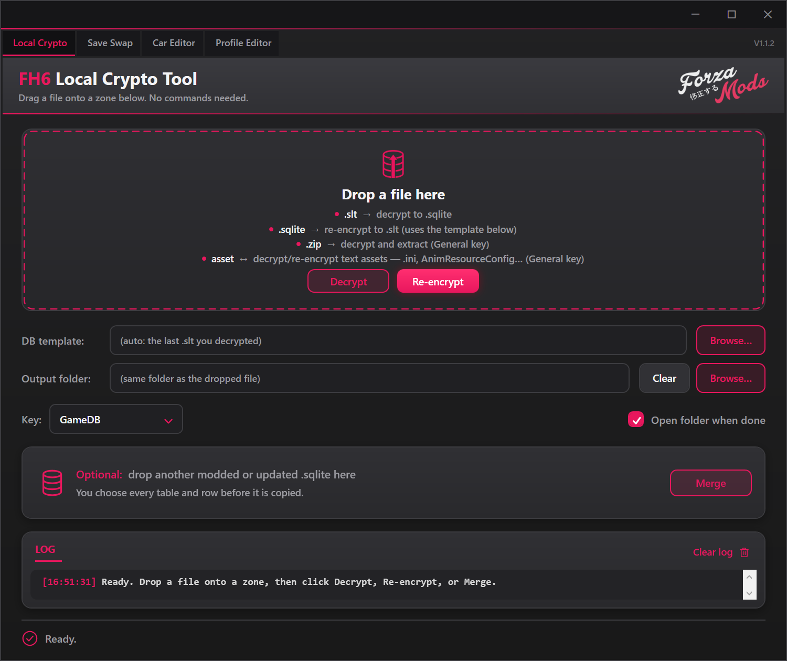

### The most important concept

The GameDB can be handled in two ways:

1. Direct workflow: load an FH2/FH5/FH6 `gamedbRC.slt` in Car Editor and export a new `.slt`. FH2 stays plain.
2. SQLite workflow: decrypt to `.sqlite`, edit/export SQLite, then re-encrypt with the original SLT template.

Both workflows use a private temporary SQLite working copy internally. The loaded file is never edited directly. FM8 must be decrypted before loading in Car Editor or DB Browser.

### Required GameDB folder setup

The walkthrough below uses FH6. FH5 uses the same override pattern through its mod setup; FH2 and FM8 installation details are in their game sections.

FH6 includes an original GameDB under `media\stripped`. Do not decrypt, edit, rename, or replace that original. Copy it into `MediaPC\stripped` and perform all GameDB work on the copy in `MediaPC`.

```text
<FH6 install>\media\stripped\gamedbRC.slt    Original source — leave untouched
<FH6 install>\MediaPC\stripped\gamedbRC.slt Working copy — load this one in Car Editor
```

Before copying, back up any `gamedbRC.slt` that already exists in `MediaPC\stripped`. It is also wise to keep an additional backup outside the game directory.

The `MediaPC\stripped` working folder might eventually contain:

```text
gamedbRC.slt                       Working encrypted GameDB
gamedbRC_modified.slt              New file exported by Car Editor
gamedbRC.decrypted.sqlite          Optional decrypted database
gamedbRC_modified.sqlite           Optional SQLite export
```

Never modify or delete the original under `media\stripped`. Use the copied `MediaPC\stripped\gamedbRC.slt` as the template when rebuilding your edited database.

## Your first complete car edit

This walkthrough covers the full process from the original game file to a rebuilt file. For your first test, make only one small and easy-to-recognize change.

### Part 0: leave the car you plan to modify

Before closing the game to begin your edit:

1. Switch out of every car you intend to modify.
2. Make an unrelated, unmodified car your currently active car.
3. Wait for the game to save the car change.
4. Close the game normally.

Do not close the game while sitting in a car you are about to change in the database. When the modified database is installed, the game may try to load that saved garage instance immediately with upgrade references that no longer match.

### Part 1: copy the original GameDB

1. Close the game.
2. Open the game's installation folder.
3. Open `media\stripped` and find the original `gamedbRC.slt`.
4. Copy the file.
5. Open `MediaPC\stripped` and paste the copied `gamedbRC.slt` there.
6. If `MediaPC\stripped\gamedbRC.slt` already exists, back it up before replacing it.
7. From this point onward, use only the copy under `MediaPC\stripped`. Leave `media\stripped\gamedbRC.slt` untouched.

### Part 2: load the GameDB directly

1. Open Forza Mod Tool.
2. Select **Car Editor** and click **Load SLT / DB**.
3. Select the copied `MediaPC\stripped\gamedbRC.slt`, not the original under `media\stripped`.
4. Wait for the car list and database totals. The editor decrypts into a private working copy.

### Part 3: edit one car

1. Select the **Car Editor** tab.
2. Keep the copied `gamedbRC.slt` loaded from Part 2.
3. Confirm the full loaded path shown beneath the Car Editor title.
4. Wait for the car list and database totals to appear.
5. Use the search box to find a car you own and can easily test.
6. Click the car once to select it.
7. Make one small change. For example, enable **Available in Autoshow** or add one sensible fitment option.
8. If you changed Wheels & Fitment, Drivetrain, or Tires & Stance, review every checked option and click **APPLY changes to this car**. Autoshow, engine, motor, price, and handling actions do not need this Apply button.
9. Read the activity log and confirm that the operation completed.
10. Click **Export SLT**.
11. Save it with a new name such as `gamedbRC_modified.slt`.

The loaded SLT is not modified. The new SLT is built from the working copy, checked, and written separately.

### Part 4: optional SQLite workflow

If you prefer SQLite, use **Crypto → Decrypt** first, load the decrypted `.sqlite` in Car Editor, and click **Export DB**. Then use **Crypto → Re-encrypt** with the original SLT template. You can also export `.sqlite` from an SLT-loaded editor. If you export an `.slt` from a SQLite-loaded editor, the tool asks for the original encrypted SLT template.

### Part 5: test the rebuilt file

1. Make sure the game is closed.
2. Back up the current `MediaPC\stripped\gamedbRC.slt` somewhere safe.
3. Copy the newly exported `gamedbRC_modified.slt` into `MediaPC\stripped` (or the re-encrypted SLT if you used the optional SQLite workflow).
4. Rename the copied file to `gamedbRC.slt` so the game recognizes it.
5. Start the game. It should load with the unrelated, unmodified car you selected before closing it.
6. Do not select an old garage copy of the car you modified.
7. Buy a fresh copy of the modified car from the Autoshow and build it again from stock.
8. Test only the database change you made.
9. If the game hangs, crashes, or behaves incorrectly, close it and restore the original backup.

Do not install the modified file into `media\stripped`. All edits and replacements belong in `MediaPC\stripped`.

Once this basic workflow succeeds, repeat it with additional edits. Testing a few changes at a time makes it much easier to identify an incompatible value.

## Which buttons require Apply?

- Checkbox-based fitment, drivetrain, tire, and stance options require **APPLY changes to this car**.
- Engine, motor, Autoshow, FE-car, global-price, and enhanced-handling buttons change the temporary working database immediately.
- Both kinds of changes still require **Export SLT** or **Export DB** to create a new file.
- Direct SLT exports are ready to install after backup and testing; SQLite exports must be re-encrypted first.
- Garage field edits use **Apply car fields** (or **Apply checked fields** for a batch), then **Export save**. Add/Remove/Duplicate/Set as current car change only the garage working copy until export.
- DB Browser uses **Write changes** for a working-copy checkpoint, then **Export as** for the output file. Each tab has its own working copy.

If a change does not appear in game, check this chain:

```text
Choose option → Apply if required → Export SLT → Install the new SLT
```

## Output-name cheat sheet

| Operation | Example input | Example output |
|---|---|---|
| Edit GameDB directly | `gamedbRC.slt` | `gamedbRC_modified.slt` |
| Decrypt GameDB | `gamedbRC.slt` | `gamedbRC.decrypted.sqlite` |
| Re-encrypt GameDB | `gamedbRC_modified.sqlite` | `gamedbRC_modified.re-encrypted.slt` |
| Decrypt text asset | `PhysicsSettings.ini` | `PhysicsSettings.decrypted.ini` |
| Re-encrypt text asset | `PhysicsSettings.decrypted.ini` | `PhysicsSettings.modded.ini` |
| Decode skeleton | `skeleton.skeld` | `skeleton.decrypted.skeld.json` |
| Rebuild skeleton | `skeleton.decrypted.skeld.json` | `skeleton.modded.skeld` |
| Extract encrypted ZIP | `Example.zip` | `Example.extracted` folder |
| Merge database | base `.slt` or `.sqlite` | new `.slt` or `.sqlite` matching the base |
| Export car-related DB | modified `.slt` or `.sqlite` | selected car's merge-only `.sqlite` |
| Import car DB | receiving `.slt` or `.sqlite` + car donor | new `.carmerge.<car-id>.<timestamp>.slt` or `.sqlite` |
| Merge updated DB | clean update + old modded DB | new `.updatedmerge.<timestamp>.slt` or `.sqlite` |
| Build save swap | target `C_ProfileData` | `C_ProfileData.swapped` |
| Edit garage | `C_ProfileData` | `C_ProfileData.garage-edited` |
| Decrypt FH6 profile | `C_ProfileData` | `C_ProfileData.decrypted` |
| Decrypt FH5 profile | encrypted save | `<save>.fh5-profile.decrypted` |
| Re-encrypt FH6 profile | `C_ProfileData.decrypted` + original profile template | `C_ProfileData.re-encrypted` |
| Export FH2 save | Azimuth revision | new revision containing `commit` and the complete `data` folder |

The tool does not overwrite the original input during these operations.

## Section 1: Crypto

Use the **Crypto** tab for encrypted GameDB files, supported text assets, ZIP extraction/rebuilding, FH6 `C_ProfileData`, and database merging. Manual GameDB decrypt/re-encrypt is optional when Car Editor loads an SLT directly.

For FH5/FH6 GameDB work, use the copied file at `MediaPC\stripped\gamedbRC.slt`. Keep the original `media\stripped\gamedbRC.slt` untouched.

### Decrypt a GameDB

1. Open **Crypto**.
2. Optionally choose an **Output folder**. Otherwise, output is written beside the dropped file.
3. Drag `gamedbRC.slt` onto the large drop area.
4. Confirm that the staged-file message identifies it as an SLT ready to decrypt. The appropriate GameDB method is selected automatically.
5. Click **Decrypt**.
6. Wait for `Decrypted OK` and check the log for a valid SQLite header.
7. The output is named `gamedbRC.decrypted.sqlite`.

The original SLT is retained and remembered as the DB template for the current session.

### Re-encrypt a GameDB

1. Start with a decrypted or edited SQLite database.
2. If you decrypted its original SLT in the same session, the template is already selected.
3. Otherwise, click **Browse** beside **DB template** and select the original matching `gamedbRC.slt`.
4. Drag the edited `.sqlite` onto the main drop area.
5. Confirm that it is staged as SQLite ready to re-encrypt.
6. Click **Re-encrypt**.
7. The output is named `<database-name>.re-encrypted.slt`.
8. Preserve the original game file, then copy and rename the rebuilt file only when ready to test.

Always use the original SLT from the same game build as the SQLite database being rebuilt.

### Decrypt and re-encrypt profiles

For normal FH6 save changes, load the complete profile directly in Profile Editor or Garage Viewer.

1. Copy the encrypted `C_ProfileData` to a separate working folder and keep a backup of the whole save.
2. Drop the copy onto Crypto and **Decrypt**. The output is `C_ProfileData.decrypted`, containing all four save sections. It does not extract a separate SQLite file.
3. The original encrypted save becomes the **Profile template**. To re-encrypt a complete `.decrypted` profile, drop it onto Crypto and choose **Re-encrypt**. After a tool restart, select the original under **Profile template → Browse**.
4. Keep the `.re-encrypted` output separate until installation. With FH6 closed and the whole save backed up, install an encrypted copy as `C_ProfileData`.

FH5 saves export a complete `.fh5-profile.decrypted` stream to the selected output folder. FH5 viewing, editing, re-encryption and Save Swap are unavailable. Older extracted FH6 profile SQLite files still work with their original profile template; they are not GameDBs. FH2 uses complete Azimuth revision export instead of this profile flow.

### Decrypt an encrypted text asset

This workflow supports authenticated text containers such as `PhysicsSettings.ini`, XML, JSON, TXT, and extensionless configuration assets, including supported FH5 General/File assets.

1. Drag the encrypted asset onto the main drop area.
2. The tool detects the container structure and selects the General method automatically.
3. Click **Decrypt**.
4. Confirm that the log reports plausible text output.
5. The output keeps the original extension and adds `.decrypted` before it. For example, `PhysicsSettings.ini` becomes `PhysicsSettings.decrypted.ini`.
6. Edit the decrypted copy with a text editor. Preserve its syntax, encoding, section names, and required delimiters.

### Re-encrypt an edited text asset

1. Keep the original encrypted asset available as the template.
2. Drag the edited decrypted text file onto the main drop area.
3. Click **Re-encrypt**.
4. If the original cannot be found automatically, select it when prompted.
5. The rebuilt output is written as `<asset-name>.modded<extension>`.
6. Check the log for a successful authenticated rebuild before testing it in game.

Do not use a different asset or a file from another game build as the template.

### Decode and rebuild a skeleton (`.skeld`)

SKELD files are **not encrypted**: they are binary BSI skeleton data. The Crypto tab uses its existing buttons to convert them to editable JSON and back; no key or external template is needed.

1. Drop `skeleton.skeld` onto the main area and click **Decrypt**. The tool writes `skeleton.decrypted.skeld.json` without changing the original.
2. In the JSON, edit an existing bone's hexadecimal `id`, `parent` index, `translation` (3 floats), `scale`, or `rotation` quaternion (4 floats). Keep `originalBase64` and `originalSha256` intact: they preserve unknown binary fields and padding.
3. Drop the edited JSON onto the main area and click **Re-encrypt**. The tool recognizes SKELD JSON even if an editor names it `skeleton.decrypted.skeld.modded.json`, then rebuilds and validates `skeleton.modded.skeld`. Do not use a generic `re-encrypted.json` asset container as a skeleton.

This conversion keeps the existing bone count and file layout. It does not add or remove bones or rebuild a car ZIP. New outputs receive a numbered name if one already exists; inputs are never overwritten. Test a modified skeleton on a backed-up car first.

### Extract an encrypted ZIP

FH5/FH6 audio ZIPs and supported ordinary ZIPs use the same extract/edit/rebuild pattern. Keep the original ZIP and metadata in the workspace, and do not add or remove entries. FH5 large archives stream to disk. Rebuilding audio does not change its codec or update external zipmanifest.xml files.

1. Drag the `.zip` onto the main drop area.
2. Format/key detection is automatic; there is no manual Key dropdown.
3. Click **Decrypt**.
4. Extracted files are written into `<zip-name>.extracted`.
5. Review the log for the authenticated entry count and total extracted size.

Supported FH6 ZIP workspaces can also be rebuilt: edit the extracted files, drop the whole folder or round-trip manifest into Crypto, and click **Re-encrypt**. Keep the original template/metadata unchanged; old FH6 extraction-only folders must be extracted again. Do not add/remove entries. For Motorsport ZIPs and their LZX dependency, see [Section 7](#cameracar-zip-rebuilding-and-the-lzx-dll).

### Share or import a car DB

1. Finish editing the car and export your modified GameDB from Car Editor.
2. Drop that modified `.slt` or `.sqlite` into Crypto's large top area.
3. Click **Export Car Related DB**, select one car or Ctrl/Shift-click several, and save one combined donor `.sqlite`.
4. Share that donor with your car mod. It contains the car's related stock and modified rows, including bodies, parts, fitment, upgrades, presets, and linked engine/motor/physics records. It is a merge donor, not a GameDB to install or re-encrypt directly.
5. To install it, put the receiving full GameDB in the top area and the exported car donor in the lower merge area.
6. Click **Import car DB**. Enable **Use donor values for conflicting rows** to replace matching rows. For a fresh replacement of those cars' current mods, tick **Drop & rebuild**, then confirm to write a new output.

The result follows the receiving DB's format: encrypted `.slt` stays encrypted, FH2 plain `.slt` stays plain, and SQLite stays SQLite. Car donors do not carry `VersionInfo`; ordinary merges/imports preserve the receiving DB's version metadata. **Drop & rebuild** removes only the donor cars' related rows, not whole tables, and blocks conflicting shared records used by unselected cars. Normal conflict overrides can affect other cars through shared engine/physics records. The general **Merge** button remains available for manual table and row selection. See the [advanced merge reference](#merge-another-database) for details.

### Merge after a game update

Use this to carry your current mods into a newer GameDB without losing the update's new content. **Close the game and back up both GameDB files first.** Leave the clean original under `media\stripped` untouched.

#### Step 1: load the new and modded databases

- Open **Crypto**. Drag the **new clean** `<FH6>\media\stripped\gamedbRC.slt` into the **top** drop zone.
- Drag your **current modded** `<FH6>\MediaPC\stripped\gamedbRC.slt` into the lower **Optional** drop zone.
- Click **Merge updated DB**, not the general **Merge** button.

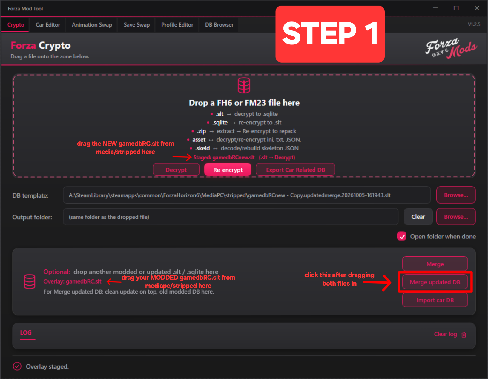

#### Step 2: create the updated database

- Check the two input filenames and the additions/edits/deletions preview.
- If asked for a clean reference, select an **untouched full GameDB from the same old game version as your modded DB**. Do not use the new update or another modded DB as that reference.
- Click **Create updated DB**. Both inputs stay unchanged.

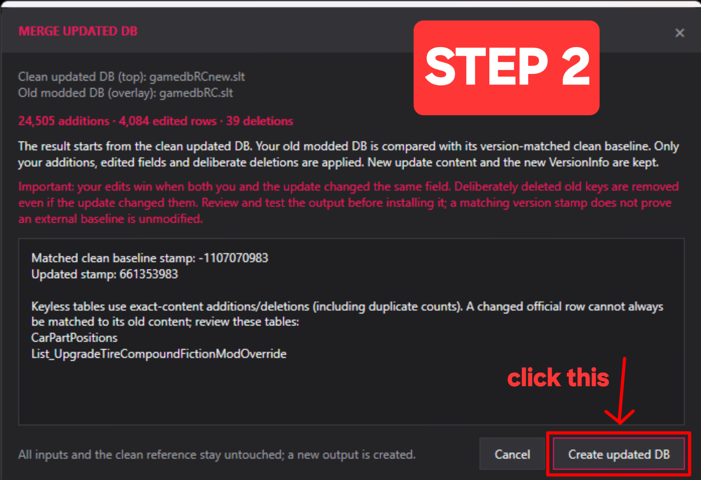

#### Step 3: install the new file

- Find the generated SLT in your selected **Output folder**, or beside the **top input** if no output folder was chosen. Its name looks like `gamedbRC.updatedmerge.<timestamp>.slt`; the prefix follows your top input's filename.
- In `<FH6>\MediaPC\stripped`, rename the old modded `gamedbRC.slt` to `gamedbRC.slt.bak`. If that backup already exists, keep it and give this backup a different name.
- **Copy** the generated SLT into `<FH6>\MediaPC\stripped` and rename the copy to exactly **gamedbRC.slt**. Do not replace anything under `media\stripped`.
- Launch the game and check your mods and the new content. If anything is wrong, close the game and restore your backed-up modded file.

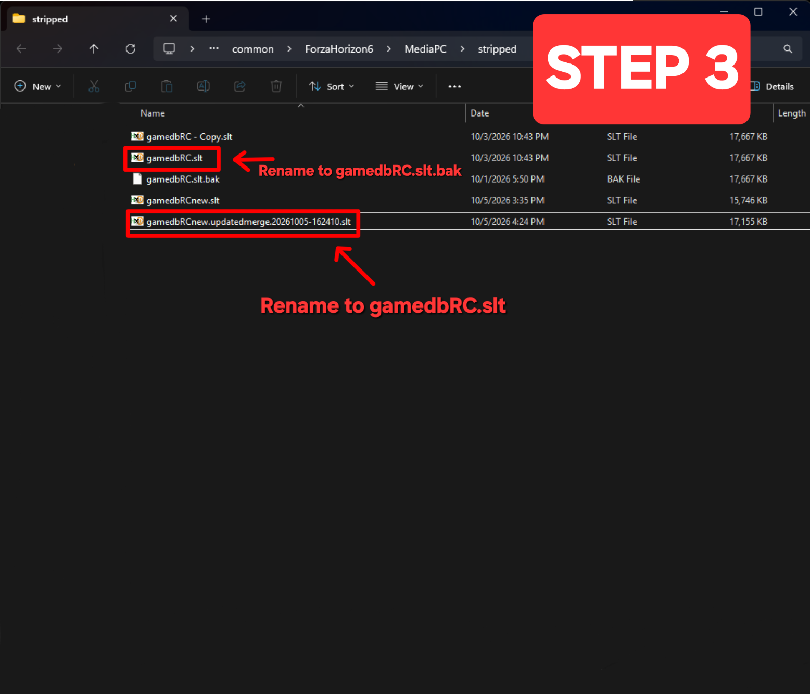

The photos show example filenames from an earlier app version; follow the same three-step workflow. For FH6 SLT inputs, the output is already encrypted: no separate decrypt/re-encrypt step is needed.

The app matches your old modded DB's `VersionInfo.database_version` to an embedded clean reference from that same game version. It compares the old clean reference with your modded DB, then applies only your additions, edited fields and deliberate deletions onto the new clean DB. Untouched official updates, new cars and the updated version stamp are retained. This action accepts same-game FH2/FH5/FH6/FM8 SLT or SQLite inputs and produces the top file's format. Unchanged old tables absent from the new update are skipped and reported; edited missing tables still stop the merge for review.

Older clean references are kept alongside newer references, not replaced. If no unique embedded reference matches, the app asks you to choose the **unmodified full GameDB from the same version as the old modded DB**. A version stamp identifies a build but does not prove a user-supplied reference is clean. Your edits win same-field conflicts; deliberate deletions of old keys win over official edits to those keys. Keyless tables use exact-content differences and duplicate counts, so independently changed official and modded variants can coexist. See the [advanced update-merge reference](#merge-an-updated-game-database-with-your-old-modded-database) and test before installing the output.

### Crypto controls

- **DB template** selects the original SLT used to frame a rebuilt GameDB.
- **Output folder** overrides saving beside the input.
- **Clear** returns output to the input file's folder.
- File staging automatically detects the supported format/key usage; no manual Key selector is needed.
- **Open folder when done** opens the completed output's location.
- **Clear log** clears only the on-screen activity history.

The activity log confirms each staged, decrypted, re-encrypted, or extracted file.

## Section 2: Car Editor

Car Editor accepts FH2/FH5/FH6 `.slt` or `.sqlite`; FH2 SLTs are plain. Decrypt FM8 to SQLite before loading it. It works on a temporary SQLite copy and exports a new file; the loaded input stays untouched. An SLT input defaults to SLT output, while a SQLite input defaults to SQLite output.

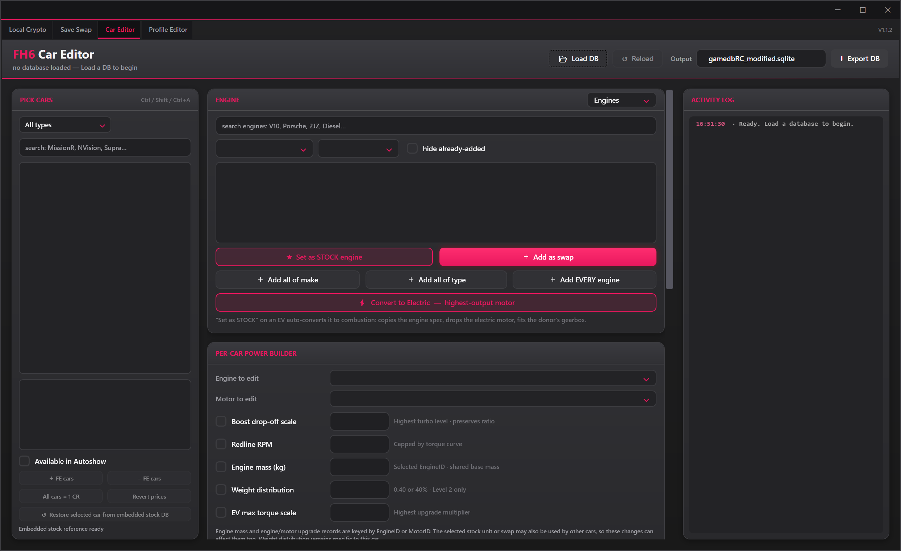

### Important: prepare and replace modified cars safely

Before closing the game to install a database edit, switch to a car you are not modifying and wait for the game to save. Never leave your character sitting in the car whose database records you are changing.

After installing the modified GameDB, treat existing garage copies of every modified car as incompatible. Buy a fresh copy from the Autoshow and rebuild it from stock before testing the changes. Older garage copies can retain references to the previous stock parts, installed upgrades, or upgrade-tree rows and may crash the game when selected or loaded.

This is especially important after:

- Applying enhanced handling or overwriting stock handling data.
- Replacing the stock engine, motor, drivetrain, transmission, suspension, or other stock configuration.
- Changing or rebuilding upgrade options that were already installed on the saved garage car.
- Removing, replacing, or repurposing database rows used by an existing build or tune.

If you modified several cars, remain in a completely unrelated car until fresh copies of the modified vehicles have been purchased and rebuilt.

### Load a database and choose a car

1. Open **Car Editor**.
2. Click **Load SLT / DB** and select the copied `gamedbRC.slt` or a decrypted SQLite database.
3. FH5/FH6 SLTs are decrypted into a private working copy; FH2 plain SLTs are copied without encryption.
4. The editor creates a temporary working copy. The selected file is not edited directly.
5. Use the search field or type filter to find a vehicle.
6. Filters include ICE, EV, ICE-to-EV, EV-to-ICE, bodykit presets, and cars modified relative to the embedded stock database. BaseCost and Autoshow availability are intentionally excluded from the Modified cars filter.
7. Select a car and review its details.

Changes remain in the temporary working database until **Export SLT** or **Export DB** is used.

The editor carries compressed, versioned stock GameDB references inside the application. It selects the reference matching the loaded database's `VersionInfo.database_version` on every load. This enables **Modified cars only** and **Restore selected car from embedded stock DB** without comparing against the wrong game build. Comparison and restoration are disabled for unknown or ambiguous versions; restoration is also disabled in batch mode and for cars absent from the matched reference.

Version 1.3.0 includes matching FH2 and FH5 stock references alongside the current and historical FH6 references. A reference must match both the game and build; the tool does not fall back to a different game. FM8 has no embedded stock reference.

**Restore selected car from embedded stock DB** restores the selected car's identifiable own records, including fields edited in DB Browser. Added swap links are removed without resetting donor engines. Engine/motor names and records used by other cars are preserved; the log lists shared changes kept. Restore changes the DB, not installed car ZIPs or thumbnail files. It was tested in-game on two replaced car definitions.

**Car bucket** shows the category name and writes the matching ID when you click **Set bucket**. It supports the selected cars and returns to the stock mapping when the car is restored.

**Stock previews:** Auto-find supports FH2/FH5/FH6 installations. FH2 follows Azimuth's configured title folder; manual selection accepts renamed/relocated game, Mount, Content, media or stripped folders. RC ZIPs are read in memory, FH5/FH6 prefer HiRes, and sources are remembered per game. Stock images show the model, not installed paint or parts. FM8 accepts extracted supported images rather than native LZX preview archives.

The selected-car summary shows its powertrain, available engine options, fitment basics, Autoshow state, and stock-restore control:

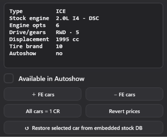

The type filter can narrow the list to bodykit presets or specific powertrain types.

### Autoshow and global prices

- **Available in Autoshow** changes availability for the selected car.
- **+ FE cars** makes every Forza Edition car available in the Autoshow.
- **- FE cars** hides every Forza Edition car, including those available in the loaded database.
- **All cars = 1 CR** sets every car's BaseCost to 1 in the working database.
- **Revert prices** restores prices captured when the current database was loaded.

These controls update the working copy immediately, but the database must still be exported.

### Engine and motor editing

The engine list contains every engine already in the open database. The tool does not bundle extra cross-game engines or audio packs. **Label stock engines** writes **donor car - engine name** for stock engines with a known donor; generic engines keep their names. Blank stock descriptions use the known donor's name. Labels are shared by EngineID, so existing swaps update too. **Restore stock names** restores the original labels from the matching reference. IDs and physics are unchanged by naming.
1. Select a car.
2. Choose **Engines** or **Motors**.
3. Search or filter the list and select an item.
4. Choose an action:
   - **Set as STOCK engine** replaces the stock engine. On an EV, it converts the car to combustion and fits a donor drivetrain when available.
   - **Add as swap** adds the engine as a selectable upgrade.
   - **Add all of type** adds every engine matching the selected layout, such as I4, I6, V6, or V8.
   - **Add EVERY engine** adds the full engine list after confirmation.
   - **Set as STOCK motor** converts the car to an EV with the selected motor.
   - **Add as motor option** adds the selected motor as an option.
   - **Add EVERY motor as a swap option** adds all motors.
   - **Convert to Electric — highest-output motor** performs an automatic conversion using the highest-output motor in the loaded database.

Engine and motor actions apply immediately to the working copy. Watch the activity log for skipped or existing entries.

Drag the grip immediately below the engine/motor list to make it taller or shorter. The dividers between the car picker, options, and activity log resize their widths. Layout changes last for the current session and do not change database contents.

ICE and EV configurations are mutually exclusive. Converting to electric removes the car's combustion-engine rows, while setting a combustion engine as stock removes its motor rows and copies an appropriate donor engine/drivetrain specification.

### Per-car power builder

The power builder can target the selected car's stock unit or one of its added swaps:

- **Boost drop-off scale** changes only the highest turbo-upgrade row for the selected EngineID and preserves the original relationship between `TorqueDropOffScale0` and `TorqueDropOffScale1`.
- **Redline RPM** edits camshaft upgrades and is capped by each row's torque-curve maximum RPM.
- **Engine mass (kg)** edits the selected stock engine or swap's shared `Data_Engine.[EngineMass-kg]` value. It is intentionally unavailable in batch mode.
- **Weight distribution** edits only the Level 2 body-weight upgrade for the selected car.
- **EV max torque scale** adjusts the highest motor-parts multiplier instead of applying a hidden conversion multiplier.

Engine mass and engine/motor upgrade tables are keyed by EngineID or MotorID. If another car uses the same unit, shared changes can affect that car too. The editor shows this warning beside the controls.

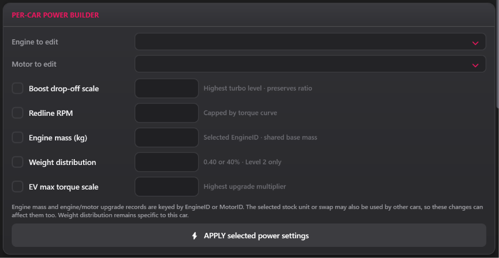

### Wheels and fitment

1. Select **Stock body** or a numbered **Widebody** tab.
2. Only the active body tab receives tire-width, tire-profile, and track-offset edits.
3. To edit stock and widebody fitment, configure and apply one tab, then switch tabs and repeat.
4. Check only the sections the next Apply operation should write.
5. Leave a box blank to skip it. Use **+** to add more absolute-value boxes, or use the repeatable step buttons to queue relative upgrades.

Numeric boxes accept either `0.05` or `0,05` regardless of the PC's region. Prefilled values display using the PC's regional decimal separator, and the compact step buttons queue the same numeric values without extra boxes. Invalid nonblank fitment values stop Apply before any rows are changed.

The **+** beside the body tabs can add a widebody kit only to a car that has no factory widebody kit. A new kit copies the required body data and stock/default part rows; it does not automatically create six extra bumpers, hoods, skirts, or wings. Cars with existing factory kits remain restricted because our tests found that adding another kit to them could crash the game. Keep an untouched database backup and test each added kit in-game before distributing it.

The five **+ Add one** rows below the body tabs add one front bumper, rear bumper, side skirt, hood, or rear-wing option with a left-click. Right-click the same button to remove the last added non-stock option in the selected body's ID block. Stock-reference parts and parts used by an upgrade preset cannot be removed this way. The first four categories belong to the selected body. Rear wings are stored per car by the game, so a new wing is visible across that car's bodies even though its ID is allocated from the selected body's range. These database options are placeholders for modders to link to matching visual parts in their car files.


Select an added Widebody tab and click **−** to remove that kit and its body-specific database rows after confirmation. Stock and factory bodykits are protected. The loaded database is unchanged until you export the editor's working copy.

For an **editor-added Widebody**, the front/rear **base track** controls edit its base geometry in absolute metres. They do not use the per-side spacer units below. Stock, factory and shared bodies are protected. Apply and export to keep the change. Added-widebody base tracks were confirmed in-game.

Each widebody tab shows its **upgrade PartId** (`List_UpgradeCarBody.Id`). The line below the tabs also shows its separate `CarBodyID`, car `Ordinal`, and level, so visual modders can coordinate existing database IDs with their car files.

The prefilled **Wheelbase (m)** and **Bottom-center wheelbase Z** boxes edit the active body's `Data_CarBody` values when you click **Apply changes to this car**. `ModelWheelbase` is displayed separately and is not changed by these boxes. Back up the database and test geometry edits in game.

If a car has more than one widebody upgrade, each widebody receives its own numbered tab. Treat every body tab separately and click Apply while the body you intend to edit is active. Rim sizes are the exception because the rim-size list is shared by the whole car.

Available fields:

- **Rim sizes:** Shared front and rear wheel diameters in inches. These are car-level, not separate per body tab.
- **Tire widths:** Absolute front and rear tread widths in millimetres.
- **Tire profile:** Front and rear aspect-ratio offsets. Negative values create a lower profile.
- **Track width / offset (FH5/FH6):** millimetres per side. Enter `20` for 20 mm on each side; the DB stores `0.040` metres total. FH2 track width and tire profile stay visible but disabled; use the separate FH2 wheel mod. FM8 direct per-car offsets use mm with their own conversion; their game-side effect remains unconfirmed.

Single-car mode keeps the prefilled absolute boxes and also provides the same repeatable controls as batch mode: rims `−1`/`+1` inch, widths `−10`/`+10` mm, profiles `−2`/`+2`, and track `+5 mm` per side by default. **Step (mm)** sets a custom track increment. Each click queues another upgrade beyond the current smallest or largest choice; right-click removes the last queued level. Tire-width, profile, and track steps apply only to the active **Stock body** or **Widebody** tab. Relative steps are append-only, preserve existing choices, and skip duplicates.

To repair older track-width names without adding widths, select one or several cars, check **Track offset**, leave new steps unqueued and Apply. Existing values can be edited after export/reload and applied again. Size labels are shared by axle/size, not per car.

#### Track-width labels and string tables

Full DB exports write any needed labels beside the exported DB under `mediapc\stripped\stringtables`. Back up your installed tables, then drag the `stringtables` folder into the game's `MediaPC\stripped`. The tool reads existing game tables and reuses correct labels; unchanged tables are not generated again. Larger sizes add missing labels without losing earlier names. Car-related exports stay DB-only; export the receiving full DB to generate its labels.

**Export string tables**, below Export, is on by default for FH5/FH6. Uncheck it for DB-only SLT or SQLite output. This skips all string-table reads and writes and keeps the DB edits. New track-width sizes still need matching installed labels to show their names in-game.

**String tables: Auto…** opens the folder picker. Choose the `stringtables` folder containing language ZIPs or language folders such as `EN\Upgrades.str`, not the `EN` folder itself. A custom selection uses that folder instead of searching other installs. **Auto** restores game-folder detection. Selections are kept separately for FH5 and FH6 during the current session.

Auto uses this order for each language:

1. `MediaPC\stripped\stringtables\<language>\Upgrades.str`
2. `MediaPC\stripped\stringtables\<language>.zip`
3. `media\stripped\stringtables\<language>\Upgrades.str`
4. `media\stripped\stringtables\<language>.zip`

The MediaPC stringtables folder does not need to exist. Auto can read the stock `media` tables and create the needed overrides beside your export. If no readable installation is found, the bundled clean tables allow offline export. Installed game files are never changed by export.

For example:

```text
gamedbRC_modified.slt
mediapc/
  stripped/
    stringtables/
      EN/
        Upgrades.str
```

Copy the generated `stringtables` folder into the game's `MediaPC\stripped` after backing up existing overrides. Keep the language folders and loose `Upgrades.str` files as generated. A valid stock `EN.zip` is supported as an input; it does not need extracting just for the tool to read it.

If a required table cannot be read, the error names its file. An unused lower-priority ZIP does not block a valid loose override. **Central Directory corrupt** is a ZIP-read error; it does not by itself mean the database is corrupt. Check that ZIP, choose a valid folder, or turn off **Export string tables** to export the DB while investigating. This setting does not repair the unreadable file.

#### Reset fitment

**Reset fitment to stock** removes non-stock front/rear rim sizes for the whole car, plus non-stock tire-width, tire-profile and track-width options from the active body. Stock rows are kept. The fields refresh after resetting so old queued sizes cannot be reapplied. Batch reset uses each selected car's stock body.

#### Multi-car batch fitment

Ctrl-click or Shift-click cars in the list to enter batch mode. Batch fitment keeps existing stock/upgraded choices and adds new values.

- Rim buttons add `−1` inch below the smallest or `+1` inch above the largest existing choice per click.
- Front and rear tire-width buttons add `−10` mm below the narrowest or `+10` mm above the widest existing choice per click.
- Tire-profile buttons add `−2` points below the lowest or `+2` points above the highest existing offset per click.
- Track-width buttons add the chosen **Step (mm)** per side beyond each axle's widest existing option. The default is 5 mm; changing it keeps already queued steps.
- Each button may be clicked repeatedly. Its count shows the number of queued levels, and right-click removes the most recently queued level.
- Queued values are stored from lowest to highest, including their database row ordering. Right-click removes the last queued level.
- Existing matching values are skipped, and pressing Apply again does not create duplicate upgrade rows. Stock values remain available in game and are not duplicated as upgrade rows, so the editor can show one intentional gap at the stock value.

Batch mode also supports suspension, drivetrain, tires, engine operations, power-builder settings, Autoshow availability, and price actions where shown. Single-car mode remains prefilled for direct absolute editing while also offering the repeatable relative step buttons.

Large batch Apply jobs group their SQLite writes into one transaction and show car-by-car progress. The editor controls are temporarily disabled so the selected settings stay fixed, but the window can repaint between cars. If Apply encounters an unexpected error, the grouped writes are rolled back. This is a CPU/SQLite optimization; no GPU is required.

### Drivetrain options

- **Add RWD conversion option** adds a selectable rear-wheel-drive conversion.
- **Add FWD conversion option** adds an experimental front-wheel-drive conversion using a valid drivetrain in the loaded database.
- **Manual transmission (EVs → geared)** gives an electric car a six-speed gearbox and transmission upgrade tree while keeping it electric.

Check the desired items, then click **APPLY changes to this car**.

### Tires and stance

Reapply Race/Drift suspension to repair older generated spring/damping ranges. FH2 uses its own Race/Rally definitions and an extra Race-tier drift choice; FH5 uses its native suspension and tire definitions. FH6-specific handling and tire options stay disabled when unsupported.

- **Whitewalls + vintage set** changes the tire brand and replaces the car's tire list with the curated vintage set.
- **Forza Edition tire set** adds FE tire models and compounds without removing current ordinary tires.
- If both tire options are checked, the vintage set is created first and FE choices are added afterward.
- **Remove suspension limit — drift suspension** creates a Drift suspension when missing and lowers its ride-height/compression limits.
- **Remove suspension limit — race suspension** is a separate, opt-in option using the same lower-limit settings for Race suspension. It creates the upgrade when needed and leaves existing Race steering angles unchanged; there is no Race steering-angle field.
- **Steering angle** sets the Drift suspension steering angle; `50.0` is supplied as the starting value.
- **Lift kit — rally suspension (+20 in)** creates a Rally suspension when missing and extends maximum ride height exactly `20 in` (`0.508 m`) above stock maximum.

Select the desired options and click **APPLY changes to this car**.

Before pressing Apply, review every checkbox in this section. A checked suspension or tire option is included even if you were mainly editing a different section.

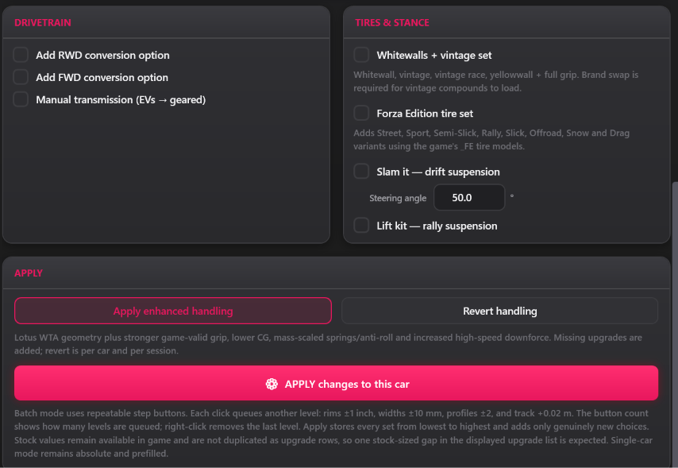

### Enhanced handling

Power/turbo and handling edits can increase the game's calculated PI, including X999 at extreme values. The tool does not preserve a fixed PI.

1. Select a car.
2. Click **Apply enhanced handling**.
3. The editor applies the handling package and creates required suspension, anti-roll, tire, chassis, and weight upgrades when missing.
4. Test extreme handling edits carefully. Large changes can produce unrealistic behavior or instability.
5. To undo it during the same editing session, select the car and click **Revert handling**.

Handling reversion is stored per car for the current session. Reloading the original database clears the session snapshots.

### Apply, reload, and export

- **APPLY changes to this car** writes checked fitment, drivetrain, tire, and stance sections to the working copy.
- Engine, motor, Autoshow, FE-car, price, and enhanced-handling buttons act immediately on the working copy.
- Pending fitment inputs and repeatable step-button clicks remain in place when you apply engine or power changes; applying fitment does not clear pending power-builder inputs. You can prepare both sections before pressing their separate Apply buttons.
- **Reload** discards current working changes and reloads the original selected database.
- **Export SLT / Export DB** writes a new encrypted `.slt` or decrypted `.sqlite`. The default matches the loaded format; a SQLite-to-SLT export asks for the original encrypted template.

Recommended finish:

1. Review the activity log for warnings or skipped operations.
2. Click **Export SLT** when an SLT is loaded, or **Export DB** for SQLite.
3. If you exported SQLite, return to Crypto and re-encrypt it with the matching original SLT template.
4. Back up the game's current SLT before installing and testing the new one.

## Section 3: Animation Swap

Animation Swap is the integrated, re-themed v2.2 animation tool. It accepts a complete car ZIP or a raw `carclips_<ID>.clipd`, keeps the source file untouched, and saves a new structurally verified result.


### Swap door animations

1. Open **Animation Swap**.
2. Drag in a clean complete car ZIP or raw `carclips_<ID>.clipd`, or click **Browse**.
3. Select **Front doors** or **Rear doors**.
4. Choose a donor car from the built-in animation library.
5. Click **Apply donor → selected animation**.
6. Front and rear doors may use different donor cars. If a donor has no rear-door data, the tool can use its matching front-door motion as a fallback.
7. Click **Save As** and test the new file in game.

The tool warns when a known car's starting animation data differs from its stock baseline. Start from a clean game file whenever possible.

### Other animation channels

Expand **Other channels (experimental)** to inspect supported hood, trunk, wing, and other non-door channels. Direction has not been verified for every car/channel combination, so test these changes carefully.

Expand **Manage CLIPD channels** to see every animation in the loaded car. Select channels under **This car** and click **Remove selected**, or load a donor CLIPD/car ZIP, select its channels, and click **Add selected**. Imports preserve the donor channel IDs and skip IDs already present; they do not overwrite an existing animation. Nothing is written until **Save As**. The tool checks the rebuilt channel count and preserves every unaffected animation record. New part animations may also require matching skeleton bones and Mojo events to play in game.

Select one channel under **This car** and click **Adjust start/end...** to edit its animation endpoints. Choose the animated track; the boxes show that track's current start and end positions (metres) and rotations (degrees) from the loaded CLIPD. Edit the values you want to change and leave the others untouched. The tool blends the changes through the frames and rebuilds that channel. Save As creates a separate patched file; keep your original and test the result in game. Other channels remain byte-for-byte unchanged, though lossy recompression can slightly change intermediate frames within the edited channel.


CLIPD stores compressed Mojo/ACL animation records, not embedded GR2 files. Blender/GR2 export and import are not available yet. The endpoint editor uses bundled ACL tools; their license notices are included alongside the app.

### Database stance compatibility

**Fix DB ride height / spacers** removes authored suspension animation channels that can override ride-height and track-width changes made in the GameDB. This is intended for cars whose animation data prevents database stance edits from rendering correctly.

### Animation output safety

- Complete ZIP input produces a complete patched ZIP with the original archive layout retained.
- Raw CLIPD input produces a new CLIPD file.
- **Reset** reloads the original source and discards unsaved animation changes.
- Before writing, the tool rebuilds and reparses the CLIPD, validates its size trailer, checks its node-stream boundary, and blocks structurally unsafe output.

## Section 4: Save Swap

Save Swap supports encrypted FH6 profiles only. FH2, FH5 and FM8 saves are not accepted.

Use Save Swap when you want to put the progress from one FH6 save into another account's save container. The save containing the progress is the **donor**. The save belonging to the account that will use that progress is the **target**.

The tool writes a new file beside the copied target and checks it before reporting success. Both input files stay unchanged.

> Save Swap has been confirmed in-game. Back up the complete target save folder before installing the result, and check which local/cloud copy the game loads.

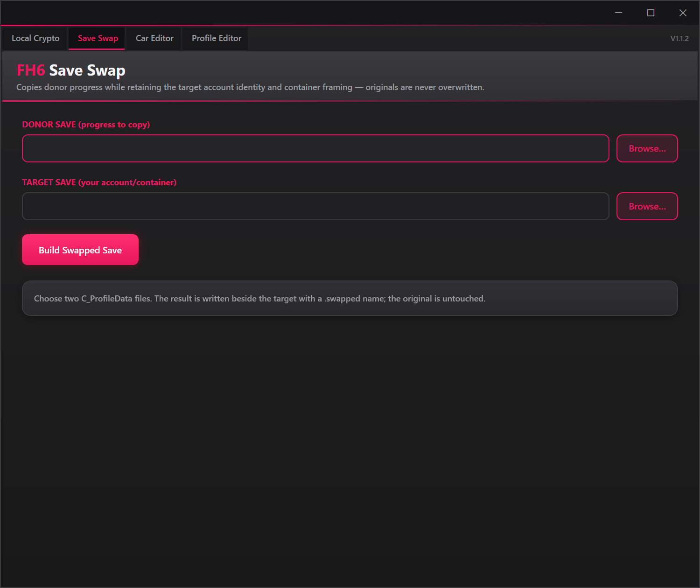

### Find your C_ProfileData

Find your FH6 profile here:

```text
C:\XboxGames\GameSave\pgs\u_<your decimal XUID>_<suffix>\current\ContainersRoot\User_<hex account ID>\C_ProfileData
```

To find it:

1. Close FH6 completely.
2. Open `C:\XboxGames\GameSave\pgs` in File Explorer.
3. Open the folder beginning with `u_`.
4. Open `current`, then `ContainersRoot`.
5. Open the folder beginning with `User_` that does not end in `_Backup`.
6. Find the file named exactly `C_ProfileData`.

You may also see `C_ProfileData_SCopy` or `C_ProfileBackup`. For the target input, use the active file named `C_ProfileData`.

Do not select the live PGS file directly in Save Swap. First copy it into a separate working folder and keep another untouched backup. This keeps the generated `.swapped` file outside the live save directory.

### Before swapping a save

1. Close the game completely.
2. Copy the active target `C_ProfileData` out of the PGS directory and into a separate working folder.
3. Keep another untouched target backup in a different folder.
4. Put the donor in its own clearly named folder so you cannot reverse donor and target.
5. Use two different encrypted `C_ProfileData` files. The same file cannot be both donor and target.
6. Be prepared for cloud synchronization. A cloud copy may replace a local file when the game starts.

### Build the swapped save

1. Open the **Save Swap** tab.
2. Under **DONOR SAVE (progress to copy)**, click **Browse**.
3. Select the encrypted `C_ProfileData` containing the progress you want.
4. Under **TARGET SAVE (your account/container)**, click **Browse**.
5. Select the copied encrypted `C_ProfileData` belonging to the receiving account.
6. Double-check the two paths. Reversing them produces the opposite swap.
7. Click **Build Swapped Save**.
8. Wait for the tool to finish and verify the rebuilt result.
9. Read the result path displayed in the status box.

### Understand the output

The first result is written beside the copied target as:

```text
C_ProfileData.swapped
```

If that filename already exists, the tool keeps it and creates a timestamped result such as:

```text
C_ProfileData.swapped.20260910-153000
```

The selected donor and target files remain unchanged.

### Install and test the swapped save

1. Do not delete the original target.
2. Move the live target `C_ProfileData` into a safe backup location.
3. Copy the newly generated swapped file into the target save location.
4. Rename the copied result to exactly `C_ProfileData`.
5. Start the game and carefully check which local or cloud save it is about to use.
6. Confirm that the expected progress loads before continuing to play.
7. If the game rejects the file, loads unexpected data, or cloud sync chooses the wrong version, close the game and restore the untouched target backup.

## Section 5: Profile Editor

The instructions below describe FH6. Use **FH2 save…** for the separate [FH2/Azimuth controls](#fh2--azimuth). FH5 save viewing/editing is disabled; Crypto decryption remains available.

Profile Editor opens an encrypted `C_ProfileData`, validates and decrypts it locally, and presents both everyday controls and advanced data views. Export creates a new encrypted result; the loaded input remains unchanged.

### Overview

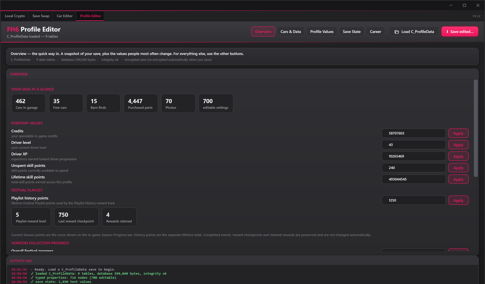

Overview shows the supported values found in your save:

- Credits, XP-derived driver level/prestige, and driver XP.
- Spendable Skill points, Wheelspins and Super Wheelspins.
- Online XP with its own level and linked Driver XP previews. Driver XP retention was confirmed after earning XP and restarting; Online XP persistence remains unconfirmed.
- Current Season Progress points and a Playlist History summary.
- Playlist reward level, last checkpoint, and claimed-reward count.
- **Complete playlist:** select a saved series to complete its seasons and activities and update Playlist History points. Rewards stay unclaimed.
- Horizon Collection and world-progress summaries; supported totals follow Journal completion.
- Character items owned, barn-find totals, car-experience unlocks, and festival-site status.

Current Season points are editable only when the tool recognizes the save layout. Editing points does not automatically complete challenges, claim rewards, or rewrite event history.

Everyday progression values use plain-language labels and individual Apply buttons:

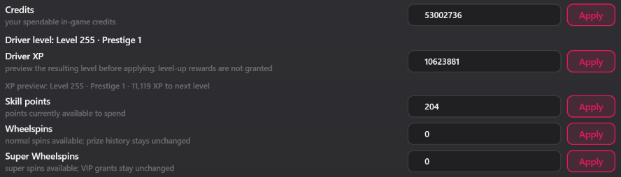

Typing **Driver XP** previews the resulting level/prestige before Apply. The display uses the game's XP curve, not the stale stored level field. Skill points is the actual spendable token balance, not raw skill-score progress; both saved copies update together while preserving Car Mastery unlocks. Spin edits preserve prize history, purchased-spin counts and VIP grants. Skill points and both spin types are confirmed working in-game. Driver XP retention was confirmed after earning XP and restarting. Online XP retention is still unconfirmed. XP edits do not grant level-up rewards.

Festival Playlist controls keep Current Season points separate from lifetime Playlist History progress:

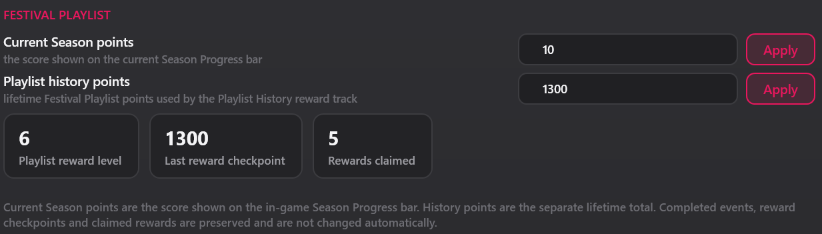

Recognized Horizon Collection categories are shown as separate progress values:

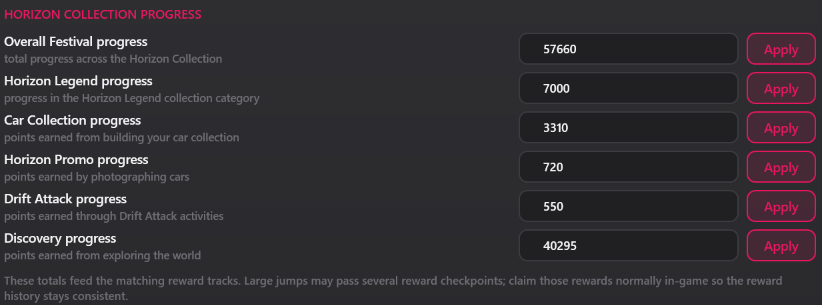

### Roads and inventory unlocks

Collection Journal Horizon Promo completion also marks the matching cars photographed in the save. It does not create photo images. Supported installed FH6 definitions can provide newer content; changed or unrecognized definitions stay read-only.

In **Overview**, open the dropdown below an **Unlock selected** button. Use its search box to filter names, categories or descriptions, select the items you want, then click the button. Ctrl-click selects multiple items; **Ctrl+A in the list** selects only visible eligible items. Filtering clears hidden selections; clearing the search does not reselect them. Press Esc in the search box to clear it. Lists start collapsed with nothing selected. Owned items are labelled; unsupported definitions are read-only. Use **Export save** to export a separate file.

**Discover all roads** stays a single button. Collection Journal keeps its existing grid and controls.

- Roads fills the supported FH6 discovery map and sets the saved road count to **671 / 671**.
- Clothes covers **498 save-managed wardrobe items** across all clothing/accessory categories. The two VIP-managed items keep their existing states.
- Horns adds missing entries from the **184-horn catalog**, keeping your equipped horn.
- Emotes adds missing entries from the **37-emote catalog**, keeping all three equipped selections.
- Forza Link lists **all 65 reward phrases**, including **33 Collection Journal rewards**. Linked horn/phrase selections also complete enough supported Journal challenges to reach their verified category-point milestone. Hidden/system messages and equipped chat slots stay unchanged.
- **Linked horn/phrase unlocks:** 37 horns and 33 phrases have verified Journal category-point requirements. Selecting one completes enough supported challenges, including medal/race/job prerequisites and automatic bonuses, then grants the selected item in one transaction. Already-owned selections can repair missing progress. Preview lists changes before applying. Mapped races, PR PBs, job rank, boards, landmarks and Story stars follow the existing Journal sync. Better PBs stay unchanged; new PR scores use the selected star cutoff + 0–2%. No Story times, actual photos, cars, purchases, online/Rivals results or reward claims are fabricated. If the loaded save's definitions cannot safely reach a required milestone, the entire selection is refused without changes. The owner confirmed this linked workflow triggered 17 Journal rewards in game; broader native progression checks remain pending.
- Badges uses **98 mapped definitions**, listing only challenge records present in the loaded save (75 in the tested older save). Missing records are not invented. Only selected supported entries are completed; existing trailing metadata, the equipped badge, gameplay stats and Collection Journal are unchanged. Changed definitions stay read-only. Forza Link also supports the older 11-context layout without creating an extra chat context.
- **Badge earned dates:** open the badge dropdown and select an unlocked badge to view/edit its precise UTC date, then click **Set earned date**. Multi-select applies one date to the selected unlocked badges; each date must fit every known series window. Date-only edits do not complete challenges or change progress.
- New unlocks preserve all existing earned dates. With the date box blank, five verified series badges use the current time while their series is active, or the last second of their series once it has ended. Their UTC windows are displayed and dates outside them are rejected. Other playlist badges require an explicitly entered date checked against the game; their exact availability windows are not verified. Future dates are rejected. Campaign/Horizon Play unlocks still use the current time unless you enter a date.
- Badge, emote and Forza Link unlocks, including custom badge earned dates, are confirmed working in-game by the project owner.

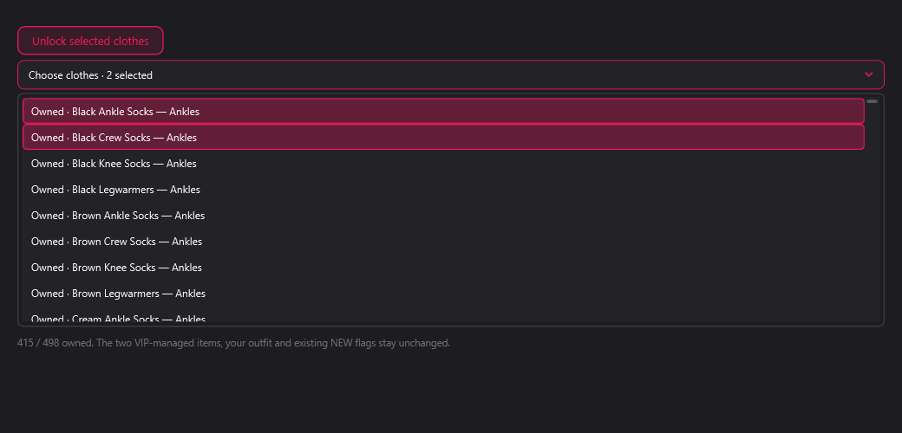

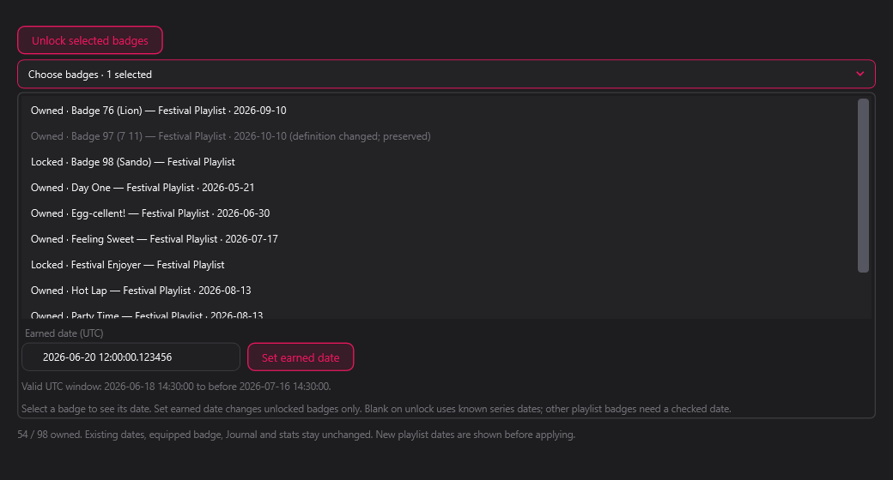

Roads, ordinary clothes/horns and Journal progression have been confirmed working in-game by the project owner. They do not grant VIP/DLC ownership, change your equipped outfit, claim rewards, or install a save automatically. Keep a full save backup.

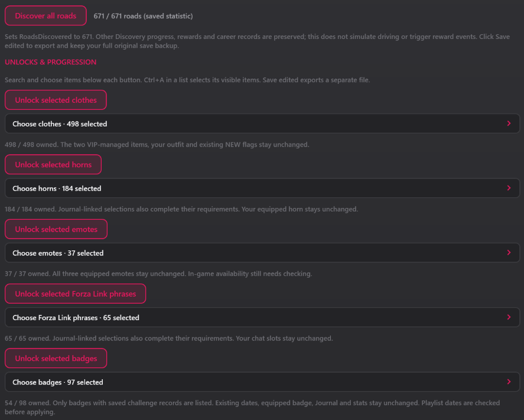

### Collection Journal

Select challenge rows, then click **Complete selected challenges**. Use **Ctrl-click** for several or **Ctrl+A** for every listed row. Clear campaign/category/search filters to select the full journal.

Points, eligible category bonuses and Festival wristbands update automatically. Mapped race finish/win rows also update the local race-result records. A win records 1st; a finish preserves an existing placing, or uses non-winning 2nd if no result exists. Existing better results are never downgraded. The Done/Auto bonus tickboxes show status; select rows rather than toggling those indicators. Bonuses remain automatic and repeated completion does not add points twice.

To repair races from an earlier Journal-only edit, turn off **Unfinished only**, select the completed race rows (Ctrl+A for all listed rows), then click **Complete selected challenges**. The confirmation reports linked races to sync. Already-completed Journal rows keep their points and dates. There are **174 exact links covering 88 base races**; seasonal route reuse, Rivals/online times and reward claims are excluded. This new race synchronization needs an in-game check.

**PR stunts:** 333 star challenges link to **111 base-map stunts**: 30 Speed Traps, 30 Speed Zones, 20 Danger Signs, 20 Drift Zones and 11 Trailblazers. Completing a star row updates its actual local Completed flag and PB using that stunt's installed medal cutoff plus a random **0–2%** margin. Select the three-star rows for three-star PBs. Existing better PBs stay unchanged, and repeating completion does not reroll them. Drift scores are whole numbers; speeds, distances and remaining times use their native save units. Seasonal stunts and online leaderboards are untouched.

**Food Delivery jobs:** promotion rows also set the actual job rank, Job XP and matching progression checkpoint. **Master Delivery Driver** sets the maximum **level 10**, at **1,606,400 Job XP**. Higher existing XP, withheld XP, unlock flags and reward claims stay unchanged. Selecting lower promotions never lowers a rank already earned.

**Boards and mascots:** linked Journal rows now set the actual collected flags for 200 XP bonus boards and 200 mascots. Board counters are raised to match collected boards without lowering historical totals. This does not grant the boards' XP, credits or reward claims.

**Landmarks:** selecting a permanent-landmark discovery row adds that location to the native discovered set. To include all 74 permanent locations, turn off **Unfinished only** and select all 70 landmark Journal rows together; seven permanent locations have no separate Journal row. Temporary car-meet triggers are not added as permanent landmarks. Changed or unavailable definitions remain untouched.

**Regions:** native sync supports full discovery only. Select the remaining region discovery rows together so all ten Journal entries are complete; already-completed entries count. This adds the verified ten-region set and reveals map fog. Individual region-to-save-ID mapping is not verified, so partial-region edits are refused without changing anything.

**Horizon Stories:** 81 star rows link to 27 chapters. Selecting a chapter's star challenge updates its native completion flag and star count, preserving better stars. Three-save comparison and the chapter UI support completion/stars as the local result. The other chapter field is a last-played date, not a finishing time. The tool does not write chapter times or online leaderboard results. In-game confirmation is still needed.

All of these changes use **Complete selected challenges**; there are no separate world-progress buttons or options. To repair earlier Journal-only edits, turn off **Unfinished only**, select the completed rows and apply them again. The highest supported medal/promotion already earned for those selected activities is respected; Journal dates and points are not awarded again. These linked progress updates have passed offline checks; **broader in-game testing is still needed**.

The journal editor covers **2,855 mapped challenges** across Horizon Festival and Discover Japan. Their points stay separate; Festival points control the wristband. It changes local Journal progress and the mapped native race, PR-stunt, job and world fields described above, not actual photos, garage cars, online times or reward-claim history. Discovery stamp/access fields are preserved. Availability can differ from the installed catalog, so only complete entries appropriate to your save.

Saves do not need to store all 2,855 entries. Compatible smaller catalogs show their saved challenges plus clearly labelled missing/changed definitions; those entries stay untouched. Partial-catalog edits add only verified points to existing totals. If a layout is unrecognized, the reference list still appears with **Unknown** completion and editing disabled. Expand compatibility details to see why; no completion state or missing entry is invented.


Journal completion, points and wristband progression have been confirmed in-game. Keep a complete save backup before changing progress.

### Advanced views

Advanced users retain direct access to the underlying profile structures:

- **Cars & Data** browses and edits supported embedded SQLite tables.
- **Profile Values** exposes the searchable property tree with friendly paths.
- **Save State** and **Career** expose parsed records and their advanced XML representation.
- XML editors include syntax highlighting while preserving the original advanced editing workflow.

Advanced edits can make a profile invalid even when the encrypted container rebuilds successfully. Change one area at a time and keep an untouched save backup outside the live save directory.

### Export a profile edit

1. Close the game and copy the active `C_ProfileData` into a separate working folder.
2. Load the copied file in Profile Editor.
3. Make and review the desired edits.
4. Export to a new encrypted file and read the verification result.
5. Keep the original backup, then install and rename the exported copy only when ready to test.

## Garage Viewer / Garage Editor (FH6)

The **Garage Viewer** tab is the garage editor. It works directly with a complete FH6 `C_ProfileData`, using a private working copy; your loaded save is not edited in place. Garage Add/Remove, setting the current car, and Original Owner/history-field edits have been confirmed working. Save editing still requires an untouched full backup: that testing is not a guarantee for every save, game build, or manual SQL edit.

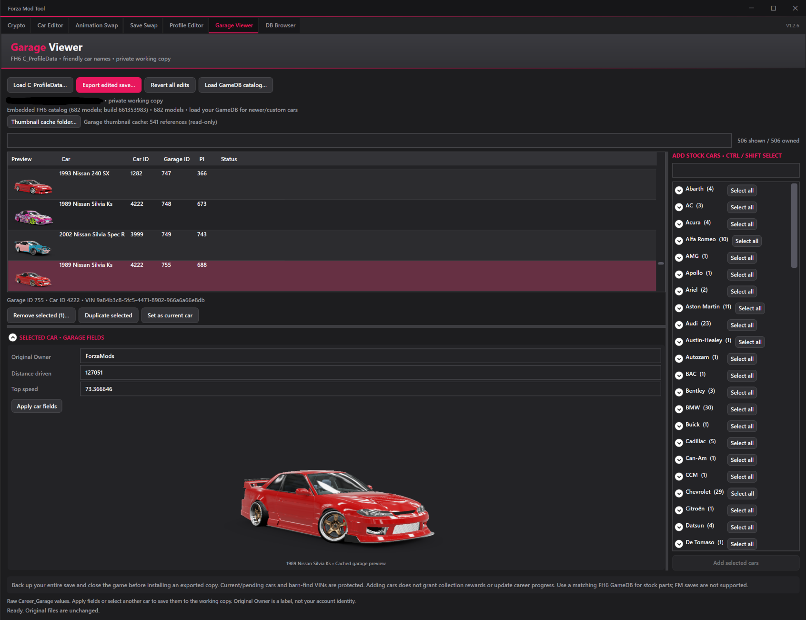

### Load and browse your garage

1. Close FH6, back up the **entire save folder**, and copy `C_ProfileData` into a separate working folder. See [where to find it](#find-your-c_profiledata).
2. Open **Garage Viewer → Load C_ProfileData…** and choose the copy. Encrypted and supported decrypted full profiles are accepted; standalone `C_ProfileData.sqlite` belongs in DB Browser, not this tab.
3. Expand a manufacturer to browse your owned cars. Search by friendly name, manufacturer, year, car ID, or garage instance ID. Cars use the same name formatter as Car Editor.
4. The built-in stock catalog loads automatically. The manual GameDB-catalog loader has been removed; no extra catalog load is needed. DLC cars still require the matching installed content/license.

Drag the horizontal divider above the selected-car fields to resize the owned list, or the vertical divider beside the stock catalog to resize its width. Collapse the fields for more list space. The slim dark/pink scrollbars match the other tabs.

### Add, duplicate, remove, or change the current car

- **Add selected cars:** select models in the right-hand stock catalog, then click the button to add one stock instance per selected model. Ctrl/Shift selects multiple models; a manufacturer's **Select all** selects its catalog group. A failed batch is rolled back together.
- **Missing cars only:** after loading a save, check this to hide models already in the full loaded garage. It combines with search and the traffic-only view. Cars added to the working copy immediately stop appearing as missing; removing or reverting recalculates the list. It uses actual garage contents, not Collection Journal ownership, and drops selections hidden by the filter. Off by default; disabled until a save is loaded.
- The default Add list contains **664 regular models**. **Traffic cars only (experimental)** switches to a separate list of **9 traffic models**; search, Ctrl+A and manufacturer selection apply only to the current list. Switching lists clears hidden selections. Six traffic variants with ambiguous stock side skirts are excluded: Legacy B4 GT (2903), G 65 AMG (4124), Acty (4125), Honda e (4126), Pajero (4127) and Stagea (4129). All 682 definitions remain available for owned-car lookup; already-owned traffic cars stay visible. Car Editor's catalog is unchanged.
- **Duplicate selected:** select one owned instance to copy its configuration and purchased parts with a new garage ID and VIN. Shared tune/livery files are not copied or deleted.
- **Remove selected…:** select owned instances with Ctrl/Shift and confirm removal. A manufacturer's **Select removable** skips protected or unknown models. Removal deletes those garage rows and their linked purchased parts, not unrelated progression or shared designs.
- **Set as current car:** select one instance to change the saved current-car reference. This is not a change to the row's general Flags field. Current/pending cars, barn-find VIN references, and catalog removal locks are protected; choose another healthy current car before removing the current instance.
- **Revert all edits:** restore the snapshot taken when the profile was loaded, including the original current-car selection.

If the current-car reference cannot be resolved but the garage can safely allocate new IDs, adding supported cars can remain available while existing-car edits are disabled. The status message explains restrictions. Adding or duplicating supported non-DLC cars also completes their matching ownership Journal entries and linked progress. DLC ownership Journal entries are excluded, and earned progress is preserved. This does not grant DLC licences, photo images or online results.

### Original Owner, Distance Driven, and Top Speed

Select an owned car to edit its **Original Owner**, **Distance driven**, and **Top speed**, then click **Apply car fields**. These are the `Career_Garage` values also shown by the advanced Profile Editor:

- Original Owner changes the car's text label, **not** the account identity/XUID.
- Distance Driven is a non-negative whole number, up to `2147483647`.
- Top Speed is a finite non-negative decimal; either `.` or `,` is accepted regardless of PC region.
- Both numeric fields use **raw database units**; the tool does not guess a kilometres/miles or speed conversion.

For batch editing, Ctrl/Shift-select owned cars and check **only the fields to replace on every selected car**. Typing checks that field automatically; uncheck it to keep each car's existing value. Mixed values show **Mixed — unchanged**. Click **Apply checked fields**; an invalid value or failed write cancels the whole batch. Checking an empty Original Owner clears the label; empty numeric values are invalid.

Selecting another car or exporting also validates pending field drafts. Invalid input is retained and blocks the action. Applying changes still does not create a save file—use **Export save** afterward.

### Actual garage thumbnails and larger previews

Previews are matched to each saved car instance's thumbnail reference, so they can show cached paint, designs, and modifications rather than generic stock images. Selecting one car shows a larger preview below the fields, growing with the panel/window. Multi-selection clears that single-car preview. Small and large images preserve the original WebP transparency.

The default cache is `%LOCALAPPDATA%\ForzaHorizon6\LocalStorage_Cache\CacheThumbnails`. **Thumbnail cache folder…** selects another location. The cache is read-only; images are not bundled or inserted into exports. Missing, stale or unreadable cached images fall back to stock previews where available; invalid thumbnails no longer interrupt scrolling. Stock fallback images are labelled and do not show saved paint or parts. Auto-find or Stock thumbnails folder chooses the source; newly added cars may need the game to generate an instance thumbnail. Windows WebP decoding support is needed for previews only; garage editing works without them.

### Export, install, and test

1. Review your selections and apply any field drafts.
2. Click **Export save** and save to a new filename such as `C_ProfileData.garage-edited`. Export keeps the loaded profile's encrypted/decrypted format; it refuses to overwrite an existing file.
3. For an **encrypted** export, keep FH6 closed, back up the live save, and install a copy named exactly `C_ProfileData`. A decrypted full-profile export must be re-encrypted in Crypto with its original profile template before installation.
4. Check local/cloud synchronization carefully and verify the garage in game. Restore the untouched full backup if the result is not accepted.

Export verifies the rebuilt payload and preservation of unrelated/account sections. Explicit current-car changes and supported ownership-Journal sync are included when requested. These checks do not establish compatibility for every possible save edit.

### Recovering a save after SQL Live Editor or GameDB edits

If a save stops loading or crashes because a car references incompatible edited parts, Garage Viewer can help remove that car and its purchased parts. Work on a **copy**, set a healthy car as current if needed, remove the affected car, and export a new encrypted save. Back up the entire save before installing and testing the recovered copy. Keep a compatible GameDB installed too; deleting a garage car does not repair broken GameDB rows.

This is a recovery route for **bad garage-car references**, not a guaranteed repair for every corrupt save. It cannot reconstruct missing data or fix unreadable encrypted containers, damaged SQLite, unsupported save layouts, unrelated progression corruption, or protected references it cannot safely remove. If the file will not load in the tool, restore a known-good full backup.

## Section 6: DB Browser

This is a native WPF database workspace inspired by DB Browser for SQLite 3.13.1, using the tool's dark/pink theme. It is an independent implementation, not an embedded copy of the Qt application.

### Main workflow

The lower-right **Scratch pad** is for notes and IDs. **Import scratch pad** reads TXT and **Export scratch pad** saves TXT. Notes stay while working with databases but clear when the tool closes. They are never executed as SQL.

- Open an FH2/FH5/FH6 SLT or SQLite database, or start a new empty database. Decrypt FM8 GameDBs in Crypto first. Each session uses an independent private working copy.
- Database Structure lists tables, views, indexes and triggers, their columns and creation SQL. Create tables/indexes through dialogs; modify table names/columns or edit view/index/trigger definitions through SQL. Delete objects with confirmation.
- Browse Data has a table selector, sortable headers, per-column filters, global text search and page navigation. Column filters accept literal text, `=exact`, numerical `>`, `<`, `>=`, `<=`, and `NULL` / `NOT NULL`.
- Edit cells directly in the grid with a double-click, F2 or typing. Enter, Tab or clicking away saves the value to the private working copy; Esc cancels the current edit. Existing storage types are preserved; a NULL cell uses the declared column type when filled. Numeric edits accept dot or comma. Invalid values/constraint failures keep the editor open and leave database values intact. Refresh reapplies filters/sorting after edits.
- The right-hand editor remains available for long text, explicit type changes, NULL, and hexadecimal BLOB values. Use Apply cell for changes made in that panel only. New records use defaults for omitted fields. Views/generated columns and tables without a safe row identity are read-only in the grid.
- Execute SQL supports queries, modification scripts, selected-text execution, F5, Ctrl+Enter, opening/saving SQL files, and an SQL log. SQL numeric literals use dots. Commands are atomic and failed/cancelled scripts roll back together. Results display up to 1,000 rows; SQL execution has a 15-second limit.
- Export CSV writes **all records** of the selected table, not only the filtered page; generated columns are omitted. Text is quoted, SQL NULL is an unquoted empty field, and blobs are hex. Import CSV appends records to an existing table with matching headers; constraints or invalid input roll back the whole import. Imports accept comma-delimited RFC-style quoted fields and are limited to 64 MB / 100,000 records. CSV is not a full-fidelity backup of arbitrary SQLite storage classes; use SQLite or SQL dumps for that.
- Import/export SQL dumps covers schema and records, including indexes, triggers and AUTOINCREMENT counters. Common external transaction wrappers are removed because the runner supplies its own atomic operation. Imports are limited to 64 MB and the SQL execution limit. Virtual-table dumps are not supported.
- Edit Pragmas shows database properties. Only user_version and application_id are editable; storage and safety settings remain read-only.
- Write changes creates a new undo checkpoint in the working copy, not the input. Revert changes restores the previous checkpoint. Export as creates a new validated SQLite or SLT file; SQLite-to-SLT export requires an original encrypted template. Existing files are never overwritten.

### Safeguards and differences

Foreign-key enforcement remains off for the GameDB modding workflow; row deletion does not automatically delete related records. Use `PRAGMA foreign_key_check;` for diagnostics. The SQL authorizer blocks ATTACH/DETACH, extension/file access, explicit transaction commands, temporary/virtual-table creation, and unsafe PRAGMAs. SQLite integrity is checked during export, but in-game compatibility still requires testing.

This implements the main local editing/import/export workflow, not every feature of the upstream application: SQLCipher encryption, remote databases, plotting, syntax highlighting/autocompletion and multiple SQL-editor tabs are not included.

Changes in this tab are not shared automatically with Car Editor or Crypto. Export the edited database and reload that output in another tab when needed.

## Section 7: Forza Motorsport (FM8)

Motorsport support uses the existing **Crypto**, **Car Editor**, and **DB Browser** tabs. The FH6 GameDB folder, direct-SLT, merge, and profile instructions above are not Motorsport installation instructions.

**For supported FM files, modifying works basically the same as FH6: decrypt/extract, edit, then export/re-encrypt/rebuild. The main installation difference is that FM has no override folder.** Close the game, back up the original, and put the finished modified file at its original location under `Forza Motorsport\Content\media\`, replacing the original with the same filename. Keep the original subfolder structure—do not put every file directly in the `media` root.

For example, a rebuilt camera ZIP replaces the original `Content\media\base\camera.zip`; a modified car ZIP replaces its original car ZIP at that car's existing path. Rename the original to `.bak` or keep a separate untouched backup before replacing it, and never overwrite an existing backup. Install only the finished encrypted database/asset or rebuilt ZIP, not the temporary decrypted/editing files. The GameDB-specific steps below show the same backup-and-replace process.

### Supported workflows

- **GameDB:** authenticated decrypt/re-encrypt for the supported Motorsport TransformIT format.
- **General text assets:** decrypt/edit/re-encrypt supported files such as `GameTunableSettings.ini`, `physicssettings.ini`, and `ClientFeatureFlagConfiguration.json`.
- **CMS:** decrypt/re-encrypt supported entries and the separately authenticated cache manifest; inspect/extract CMS archives, including extensionless cached ZIPs. This does not automatically install or update a CMS cache.
- **Car Editor:** edit decrypted Motorsport SQLite using shared-schema options, including engines, power, suspension, rims/tire widths, and BaseCost. Missing FH6-only options are disabled.
- **Track offsets:** separate native per-car controls with input validation and reset to loaded values. Their in-game effect still needs testing.
- **ZIPs:** extract/rebuild supported camera/car LZX ZIPs, or extract large/deduplicated track ZIPs without rebuilding them.

### GameDB editing
Drop supported gamedb.slt into Crypto, Decrypt, edit the resulting FM SQLite in Car Editor or DB Browser, export SQLite, then Re-encrypt in Crypto with the original FM SLT template. Car Editor and DB Browser use decrypted FM8 SQLite; Crypto merge actions can take FM8 SLTs directly. FM shared-schema edits are enabled and unsupported options are disabled. No FM8 profile/garage/save swapping is supported.

### Install a modified Motorsport GameDB

Motorsport has **no override folder** for this workflow.

1. Close the game and open `Forza Motorsport\Content\media\base\`.
2. Rename the original `gamedb.slt` to `gamedb.slt.bak`. If a backup already exists, preserve it and back up the current file under another name; never overwrite the backup.
3. Copy the new **re-encrypted** modified file into this same folder and name it exactly `gamedb.slt`. Do not install a decrypted SQLite file.
4. Keep the original backup untouched so it can be restored. A separate backup outside the game folder is recommended.

### Camera/car ZIP rebuilding and the LZX DLL

FH2 save editing/export and FM8 method-21 LZX operations require **[x64 xcompress64.dll](https://github.com/D3FEKT/ForzaTechStudio/blob/Main/ForzaTechStudio/Native/xcompress64.dll)** beside `FH6ModStudio.exe`. Click **Download raw file** on GitHub, put the DLL beside the EXE, then restart the tool. The DLL is not included in the release. See [download/setup instructions](../NATIVE_RUNTIME.md).

1. Drop a supported Motorsport camera/car ZIP onto **Crypto** and click **Decrypt**.
2. Edit files in the new extracted folder, keeping `forza-zip-roundtrip.json` and `.__original.zip` unchanged.
3. Drop the **whole extracted folder** (or its manifest) back into Crypto and click **Re-encrypt**.
4. Review the verified new `.modded.zip`; the original remains untouched. Do not add/remove entries.

Modified Motorsport camera/car ZIPs have been confirmed working in game.

### Track ZIP extraction

Track ZIPs use **extract-only** mode. The tool automatically looks for the matching `pcfamily\Dedupe.zip` (or a copy beside the input), resolves shared references, and checks decoded sizes/CRCs. Keep the matching shared archive available.

The output contains `forza-extract-only.json`, not a round-trip ZIP template. Track outputs and CMS archive extractions cannot be rebuilt through the camera/car ZIP workflow.

### Pricing limitations

CMS showroom-price edits change the purchase preview, but attempting to buy returns a server error. BaseCost edits did not change tested shop prices. This is not a working discounted-purchase mod or an automatic CMS installer. Boost edits and added rims displaying 0 CP have been confirmed in game.

Back up originals and test modified outputs in game. Successful cryptographic or SQLite validation does not guarantee the game accepts an edit.

## Temporary workspace

Temporary working copies use the normal Windows temporary folder (`%TEMP%`), usually on C:, under `ForzaModTool\Work`. The tool follows your existing Windows configuration.

## Troubleshooting

Online XP persistence remains unconfirmed. The reported Car Collection display of **4,500 / 4,480** is unresolved; this release does not claim a fix. Extreme power/handling values can raise the game's calculated PI, including X999.

When testing another DB, make sure it includes your current car and every house display car. A smaller DB can leave the save pointing to absent models. Move those cars out of display slots while using the matching DB before trying a reduced test DB.

### A change does not appear in game

1. Confirm that **APPLY changes to this car** was clicked for checkbox-based options.
2. Confirm that **Export SLT** or **Export DB** was clicked after editing.
3. Confirm that the exported database—not the original input—was re-encrypted.
4. Confirm that the rebuilt SLT was renamed and placed in the correct game folder.
5. Check whether Stock body was edited while a Widebody was being tested, or the reverse.

### Re-encryption requests a template

Select the original encrypted file that produced the decrypted file. Database and text-asset templates are not interchangeable.

### The game hangs, crashes, or rejects a file

1. Restore the original backup immediately.
2. Check whether the game tried to load an old garage copy of a modified car.
3. With the original database restored, switch to an unrelated car and allow the game to save before closing it.
4. Reinstall the modified database, then buy a fresh Autoshow copy of the modified car and rebuild it from stock.
5. Verify that the template came from the same game build.
6. Repeat with one small edit.
7. Check the activity log for warnings.
8. Avoid combining multiple untested modifications at once.

## Advanced technical reference

The sections above cover normal use. The details below are intended for users who want to understand the file flow, or combine database content.

### Terminology

- **GameDB:** The main vehicle and upgrade database stored as `gamedbRC.slt` in the game.
- **SLT:** The encrypted GameDB container used by the game.
- **SQLite:** The decrypted, editable form of the GameDB.
- **Template:** The original encrypted file whose container structure is reused during re-encryption.
- **Working copy:** The temporary database Car Editor changes while the app is open.
- **Export:** Writing the Car Editor working copy to a new SQLite file.
- **Donor save:** The save whose progress you want to copy.
- **Target save:** The save whose account and container will receive the donor's progress.
- **Stock body:** The car's standard body configuration.
- **Widebody:** A separate upgraded body configuration with its own compatible fitment rows.

### Save Swap internals

Save Swap decrypts and validates both encrypted inputs in memory. It takes the donor's complete progress payload, structurally identifies the target profile's canonical account XUID, writes that one account value into the donor payload, and rebuilds the result using the target save's outer container framing.

Other creator, tune, livery, downloaded-content, and incidental identity records inside the donor data are left unchanged. The converted payload is compressed and encrypted with the target template, then decrypted again to verify both the rebuilt payload and canonical account identity before output is accepted.

Save Swap is separate from the Profile Editor. It expects encrypted `C_ProfileData` files for both donor and target and does not expose manual account-identity changes. The application does not identify gamertags, contact Xbox services, or require Xbox authorization; processing happens locally.

Save compatibility can still depend on the game build and the data inside each profile. Successful cryptographic verification proves that the container round-tripped correctly, but cannot guarantee that every donor payload is compatible with every target account or game version.

### Merge another database

To share just one edited car, drag the modified `.slt` or `.sqlite` onto Crypto's main drop area. Click **Export Car Related DB**, choose the car, and save a new `.sqlite`. This creates a merge-only donor containing the selected car's related DB rows, including stock body and parts, car-wide upgrades, linked engines/motors and their upgrades, torque curves, tire-friction/affect curves, component makers, make/bucket lookups, media/content registrations and declared foreign-key dependencies. Source values, duplicate rows and thumbnail paths are kept. It exports DB data only; car ZIPs, thumbnails and other files must be shared separately. The original DB stays untouched. The donor is not a complete game DB: do not re-encrypt it directly or use **Replace whole table**.

To install this donor, stage the receiving `.slt` or `.sqlite` in the main drop area, stage the exported one-car `.sqlite` in the merge area, and click **Import car DB**. This is a separate one-click action; it does not open the general table/row picker. It creates a new output in the base format and lets you choose whether donor rows replace conflicts. New rows are added, matching rows are updated only when that option is checked, and base-only rows remain. An export made with an earlier sparse-export build must be exported again to use this action. Linked shared records can affect other cars after merging, so test the result in-game. Deleted rows in the source are not represented by normal import. **Drop & rebuild** follows the same dependency mapping, replaces the selected cars' private records and protects records shared with other cars. It refuses incomplete older donors that would leave missing dependencies; re-export those cars from the full DB first.

1. Drag a base `.slt` or decrypted `.sqlite` onto the main Crypto drop area.
2. Drag another modded or updated `.slt` or `.sqlite` onto the smaller merge area. The two inputs may use different formats.
3. Click **Merge** to open the themed selection window.
4. Each listed table offers two different actions:
   - **Merge rows** selects new or changed donor rows. Matching rows are updated, new rows are added, and base-only rows remain.
   - **Replace whole table (drop + rebuild)** removes the staged table, recreates it from the donor schema, and copies the complete donor table. Use this only when the donor intentionally defines that entire table.
5. Expand a table to choose individual rows, or use **Merge rows** to select all displayed row changes in that table.
6. Review conflicts and base-only counts before confirming. Base-only rows are removed only from tables explicitly marked **Replace whole table**.
7. Partial donor databases containing only selected tables or rows should use **Merge rows**, never whole-table replacement.
8. The output is staged automatically and matches the base format: `<base-name>.modmerge.<timestamp>.slt` for an SLT base or `.sqlite` for a SQLite base. The SLT path needs no separate re-encryption.

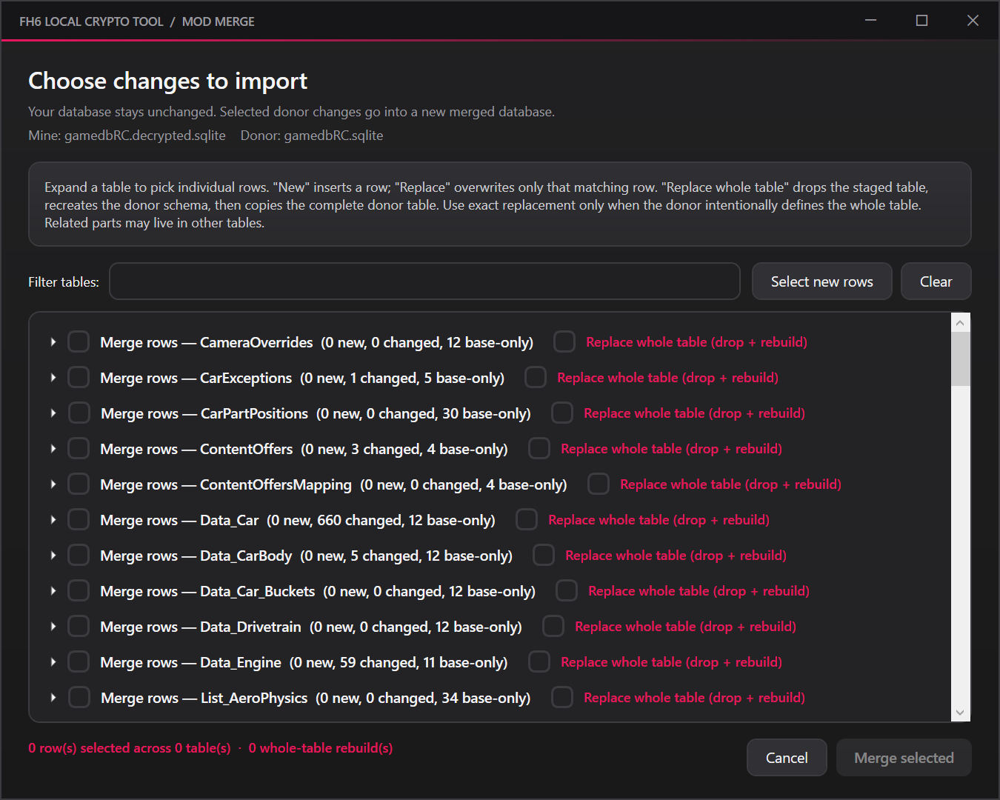

The staged database remains the base, and neither source file is overwritten. Whole-table rebuilds preserve the donor table definition, keys, row IDs, indexes, and triggers, then verify the copied contents and SQLite integrity. Keep backups: structurally valid rows can still be incompatible with another mod or game build.

### Merge an updated game database with your old modded database

This is a **separate** Crypto action; the general **Merge** picker and **Import car DB** keep their existing row-selection behavior and do not infer deletions. Put the clean GameDB from the new game update (`.slt` or `.sqlite`) in the **top** Crypto drop area. Put your **old modded full GameDB** in the smaller **lower merge** area, then click **Merge updated DB**. Review the matched baseline stamp and addition/edit/deletion counts, then confirm. The result is a new file in the top input's format; all sources and the clean reference stay untouched.

This is a **three-way comparison**: old clean baseline, old modded DB, new clean update. A baseline key missing from the modded DB is a deliberate deletion and is removed from the output, including engine/motor upgrade rows deleted for ICE/EV conversions. Rows added only by the official update are not mistaken for deletions. For keyed existing rows, only fields differing from the old baseline are copied, preserving official edits to untouched fields. User changes win when both sides edit the same field. A user-edited key removed by the official update is restored from the donor; review such conflicts before using the result. New user-added keys win collisions with update-added keys. The new update's `VersionInfo` stays unchanged.

Tables without keys, including car-part positions, use exact row content and multiplicity rather than trusting row IDs. Their old deleted content is removed and newly added content is copied. If the update independently changed the same keyless row, its new variant may remain alongside the modded variant; review the listed tables. Unchanged baseline tables absent from the new update are skipped and reported. Edited missing tables, incompatible column/key schemas and known sparse car exports stop the update merge for review. New donor-only tables are supported; dropping an entire baseline table is not applied automatically. Structural/FK checks are safeguards, not a guarantee of in-game compatibility.

## Video guide

A video walkthrough is planned. Community-made guides are also welcome.

## Disclaimer

Forza Mod Tool is an unofficial project and is not affiliated with or endorsed by Microsoft, Xbox, Playground Games, or Turn 10 Studios. Keep backups and use modified files at your own risk.

## Credits

- JXRDN — Project creator, feature direction, UI design, research, and extensive in-game testing.
- Draff — Original Botan-based cryptography work, technical research, reference material, save-swap guidance, and now the newly added save editor.
- The Botan Project — Legacy crypto research/reference credit; this release uses managed .NET cryptography, not a bundled Botan binary.
- Smidge — Provided the reference database and schema examples that helped make additional upgrade options possible.
- Stalin — Identified and helped correct text-asset round-trip requirements
- Codex — Development assistance, debugging, automated round-trip testing, UI refinement, and documentation.
- DB Browser for SQLite (https://github.com/sqlitebrowser/sqlitebrowser) UI/workflow reference
- ForzaTechStudio (https://github.com/D3FEKT/ForzaTechStudio)
