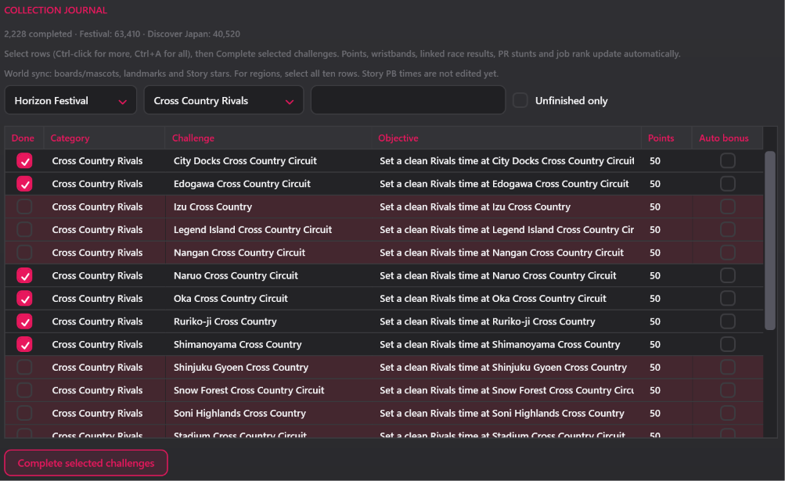

# Forza Mod Tool — 1.2.6.3

Edit supported Forza Horizon 6 and Forza Motorsport files. **Profile Editor, Garage Viewer and Save Swap are FH6-only.**

## Start here

1. Download the **app ZIP** from Releases, not a Source or GitHub upload ZIP.
2. Extract the whole ZIP into a normal folder.
3. Run **FH6ModStudio.exe**. Keep the included DLLs, animation helper and `licenses` folder beside it.

The app EXE is protected and runs on Windows 10/11 x64 without a separate .NET installation. The ZIP is a normal archive, not password-encrypted. Source/docs packages are for building or updating GitHub, not running the app.

## Back up first

- **Back up the entire save folder**, not just `C_ProfileData`. Also back up every game file you plan to replace.
- Keep untouched backups outside the game folder. Never overwrite your only backup.
- Work on copies. Close the game before installing edited files.
- Test a small change first. If the game crashes or rejects it, restore the backup.

The tool edits a private working copy. **Apply does not install a mod, and exporting does not replace your live save.** You install the exported file yourself.

## Where to find your files

`<FH6>` and `<FM>` mean your game's installation folder. In Steam, right-click the game → **Manage → Browse local files**. Other launchers have their own install-folder option.

| File | Location | Used for |
|---|---|---|
| Original FH6 GameDB | `<FH6>\media\stripped\gamedbRC.slt` | Copy from here; leave this original untouched |
| Working FH6 GameDB | `<FH6>\MediaPC\stripped\gamedbRC.slt` | Car Editor, Crypto and DB Browser |
| FH6 car ZIPs | `<FH6>\media\Cars\<car>.zip` | Animation Swap |
| FH6 profile save | See the save path below | Profile Editor, Garage Viewer and Save Swap |
| Motorsport GameDB | `<FM>\Content\media\base\db\gamedb.slt` | Decrypt in Crypto before editing |
| Motorsport camera ZIP | `<FM>\Content\media\base\camera.zip` | Crypto extraction/rebuilding |
| Other Motorsport assets | Their original subfolders under `<FM>\Content\media\` | Supported Crypto workflows |
| Tool temporary files | `%TEMP%\ForzaModTool\Work` | Scratch files, not files to install |

### FH6 save location

On the Xbox Gaming Services layout used by this tool's tested saves:

```text
C:\XboxGames\GameSave\pgs\u_<account>_<suffix>\current\ContainersRoot\User_<account>\C_ProfileData
```

Start in `C:\XboxGames\GameSave\pgs`, open your `u_` folder, then `current\ContainersRoot\User_...`. The drive can differ. Other save layouts may differ too.

Use the active file named exactly **C_ProfileData**, not `C_ProfileData_SCopy`, `C_ProfileBackup` or a `User_..._Backup` folder. Back up `C_ProfileData`, then copy `C_ProfileData` into a separate working folder.

## Choose a tab

| Tab | What it does | What to load |
|---|---|---|
| **Car Editor** | Change car availability, upgrades, power, handling and fitment | FH6 `.slt` or editable `.sqlite`; Motorsport uses decrypted SQLite |
| **Profile Editor** | Edit Skill Points, Wheelspins, Super Wheelspins, XP(Levels), Clothes, Horns, Forza Link Phrases, and Collection Journal | FH6 `C_ProfileData` |
| **Garage Viewer** | Add/remove cars and edit owned-car fields | FH6 `C_ProfileData` |
| **Animation Swap** | Swap door animations and adjust supported channels | A copied car ZIP or `carclips_<ID>.clipd` |
| **Save Swap** | Copy another save's progress into your account's container | Two copied, encrypted FH6 profiles |
| **Crypto** | Decrypt/re-encrypt files, extract/rebuild supported ZIPs, and merge databases | The relevant copied game file |
| **DB Browser** | Inspect tables or make manual database/SQL edits | SQLite, or a supported FH6 SLT |

**Each tab has its own working copy.** To combine edits from different tabs, export from the first tab and load that exported file into the next one.

### Car Editor: change a car

1. Before editing, switch to an unrelated car in-game, let the game save, then close it.
2. Copy the original FH6 GameDB from `media\stripped` into `MediaPC\stripped`. Back up any existing override first.
3. Open **Car Editor → Load SLT / DB** and select the copy in `MediaPC\stripped`. No manual decrypt step is needed for FH6.
4. Search for a car and make your changes. Checkbox-based fitment, drivetrain, tire and stance options need **APPLY changes to this car**. Engine/motor, price, Autoshow and handling action buttons apply immediately to the working copy.
5. Click **Export SLT** or **Export DB** and save a new file.

To install an FH6 GameDB edit, put the exported **encrypted SLT** in `<FH6>\MediaPC\stripped\`, named exactly `gamedbRC.slt`. Leave `media\stripped` untouched. If you exported SQLite, re-encrypt it in Crypto first.

Test with a fresh Autoshow copy of the edited car. An old garage instance can retain incompatible upgrade references.

### Profile Editor: balances, unlocks and Journal

1. Click **Load C_ProfileData** and load your working copy.
2. Use **Overview**. Enter a balance or XP value, then click its **Apply** button. XP shows a level/prestige preview; it does not grant level-up rewards.
3. For clothes, horns, emotes, phrases or badges, open the list under the button. Search, select items, then click **Unlock selected**. **Ctrl+A selects visible items only.** Review the confirmation.
4. For Collection Journal, select **rows**, then click **Complete selected challenges**. The tickboxes show status; they are not buttons. Clear filters before selecting the whole Journal.
5. Click **Save edited** and save a separate output.

Journal edits update points, bonuses and wristbands, plus supported race/PR/job/world progress. Linked horn and phrase selections also complete their Journal requirements. Better PBs are preserved; new PR results use the selected star cutoff + 0–2%. Stories use completion/stars, not invented times. To discover regions, complete all ten region rows together.

Badge earned dates use **UTC**. Preserve real dates, follow the displayed playlist window, and check the actual availability before entering a date for an unverified series.

Missing or changed definitions stay read-only. Unlocks do not grant DLC licenses; Journal entries do not add actual cars, photos or online results.

<details>
<summary>Profile Editor screenshots</summary>




</details>

### Garage Viewer: manage owned cars

1. Click **Load C_ProfileData…** and choose a working copy of your save.
2. To add cars, use the right-hand list. **Missing cars only** hides models you already own; traffic cars have a separate experimental list.
3. Select owned cars to remove/duplicate them, change the current car, or edit owner/history fields. Field edits need **Apply car fields**.
4. Click **Export edited save…** for a separate output.

Use **Load GameDB catalog…** with your matching full FH6 GameDB for newer/custom cars. A single-car donor is not a full catalog. Adding a DLC car does not grant its DLC license.

### Animation Swap: change animations

1. Browse to a copied complete car ZIP, or a raw `carclips_<ID>.clipd`.
2. Choose the donor and front/rear door channels, then apply the swap. Other channels and endpoint adjustments are advanced options.
3. Use **Save As** to write a new file. Keep the input untouched.

For FH6 car-ZIP overrides, use `<FH6>\MediaPC\Cars\` with the original car ZIP's filename; keep the original under `media\Cars` untouched. A raw CLIPD is not a complete installable car ZIP. See the [detailed guide](docs/ADVANCED_GUIDE.md#section-3-animation-swap) for raw-file and stance workflows.

### Save Swap: use another save's progress

1. **Donor** = the encrypted save containing the progress you want.
2. **Target** = a copy of your own encrypted save.
3. Check the paths, then click **Build Swapped Save**.
4. The new `.swapped` file is written beside the copied target. Neither input is overwritten.

Do not reverse donor and target. Save Swap does not grant DLC ownership or guarantee compatibility with every save/build.

### Crypto: convert or merge files

- **Decrypt:** drop a copied encrypted file into the main area, then click **Decrypt**. Edit the resulting SQLite/text file or extracted folder.
- **Re-encrypt:** load the edited output and choose its matching original **template** when asked. A template is the untouched encrypted file used to rebuild the container.
- **ZIP rebuild:** only use supported round-trip workspaces. Keep their original/template metadata; do not add/remove entries. Track/CMS extractions are not normal rebuildable ZIPs.
- **Share cars:** put a full modified GameDB in the top area → **Export Car Related DB** → select cars. To import, put the receiving full GameDB on top, the car donor in the lower merge area, then **Import car DB**. A car donor is not a complete GameDB to install.
- **After a game update:** new clean GameDB on top, old modded full GameDB below → **Merge updated DB**. Review the preview. This needs a matching stock reference.

Leave **Drop & rebuild** off unless you intend to replace the donor cars' existing mods. General table/row merging is advanced; follow the [detailed merge guide](docs/ADVANCED_GUIDE.md#merge-another-database).

### DB Browser: manual database editing

1. Open a database and choose a table.
2. Edit cells or run SQL only if you know what those fields do.
3. **Write changes** checkpoints the working copy. **Export as** writes the separate output you actually keep.

An exported `.sqlite` is an editing file, not a game-ready encrypted database. Re-encrypt it if needed. DB Browser changes are not automatically shared with the other tabs.

## Install an edited save

With the game closed, back up the whole active save folder. Copy your **encrypted** exported/swapped profile into that folder and name the copy exactly **C_ProfileData**. Keep the backup untouched.

A decrypted profile or `C_ProfileData.sqlite` cannot be installed directly. Re-encrypt it with its matching original profile template first. Cloud sync can replace local changes, so verify the result after saving/reloading.

## Motorsport: the important differences

Decrypt the supported `gamedb.slt` in **Crypto**, edit the SQLite in **Car Editor** or **DB Browser**, export it, then re-encrypt with the original Motorsport template.

FM has **no MediaPC override folder**. Back up the original, then put the finished encrypted file/rebuilt ZIP at its original path under `<FM>\Content\media\`, with its original filename and subfolder. Do not install decrypted SQLite.

Supported LZX camera/car ZIP operations require your legally obtained **x64 xcompress64.dll** beside the app EXE. It is not included. See [setup instructions](NATIVE_RUNTIME.md). Track archives are extract-only. Profile/garage/save swapping are not supported for FM.

## If something goes wrong

- **Change missing?** Check Apply → Export → install the exported file, not the input. Check that you loaded the previous tab's export when combining edits.
- **Template requested?** Use the matching original encrypted file from the same game/build.
- **Save option disabled?** Read the status/compatibility message. Do not force unsupported fields through SQL.
- **Game hangs or crashes?** Close it, restore the backup, then retry one small edit. For GameDB car changes, switch away first and test a fresh car instance.

More help: [detailed guide](docs/ADVANCED_GUIDE.md) · [changelog](CHANGELOG.md).

## Disclaimer

Unofficial tool; not affiliated with Microsoft, Xbox, Playground Games or Turn 10. Back up your files and use edits at your own risk.

## Credits

- JXRDN — Project creator, feature direction, UI design, research, and extensive in-game testing.
- Draff — Original Botan-based cryptography work, technical research, reference material, save-swap guidance, and now the newly added save editor.
- The Botan Project — Legacy crypto research/reference credit; this release uses managed .NET cryptography, not a bundled Botan binary.
- Smidge — Provided the reference database and schema examples that helped make additional upgrade options possible.
- Stalin — Identified and helped correct text-asset round-trip requirements
- Codex — Development assistance, debugging, automated round-trip testing, UI refinement, and documentation.
- DB Browser for SQLite (https://github.com/sqlitebrowser/sqlitebrowser) UI/workflow reference
- ForzaTechStudio (https://github.com/D3FEKT/ForzaTechStudio)
